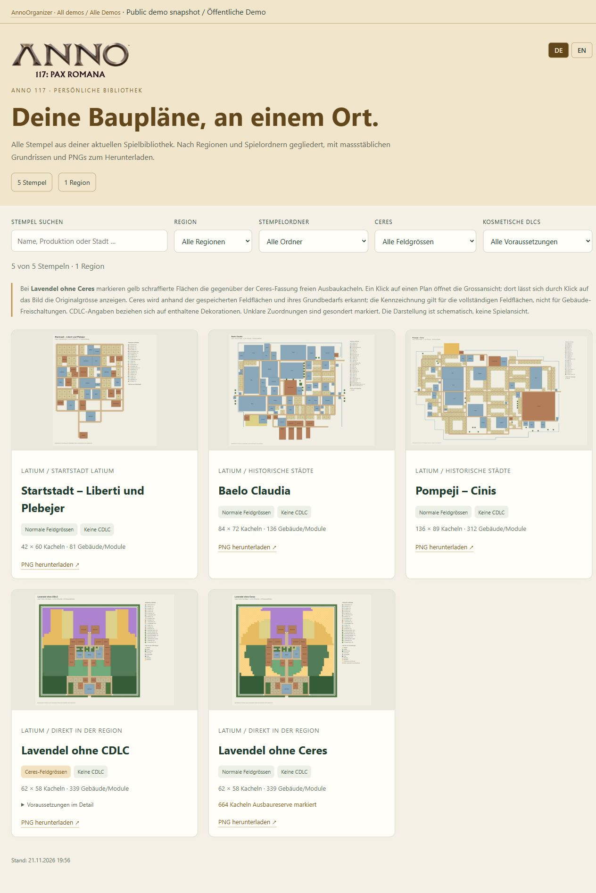
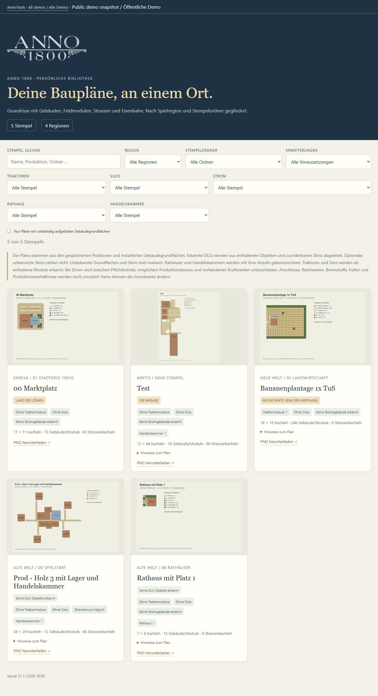
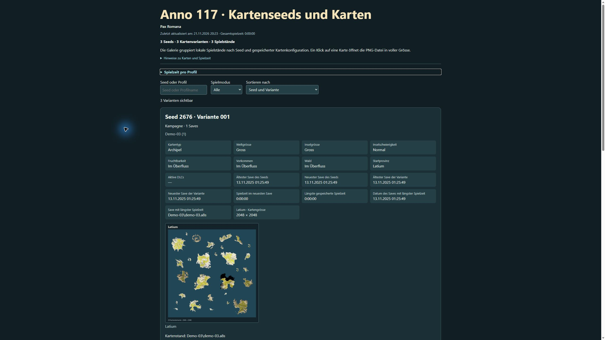
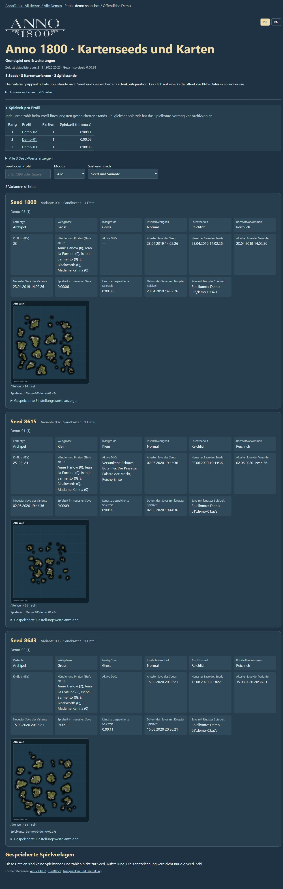
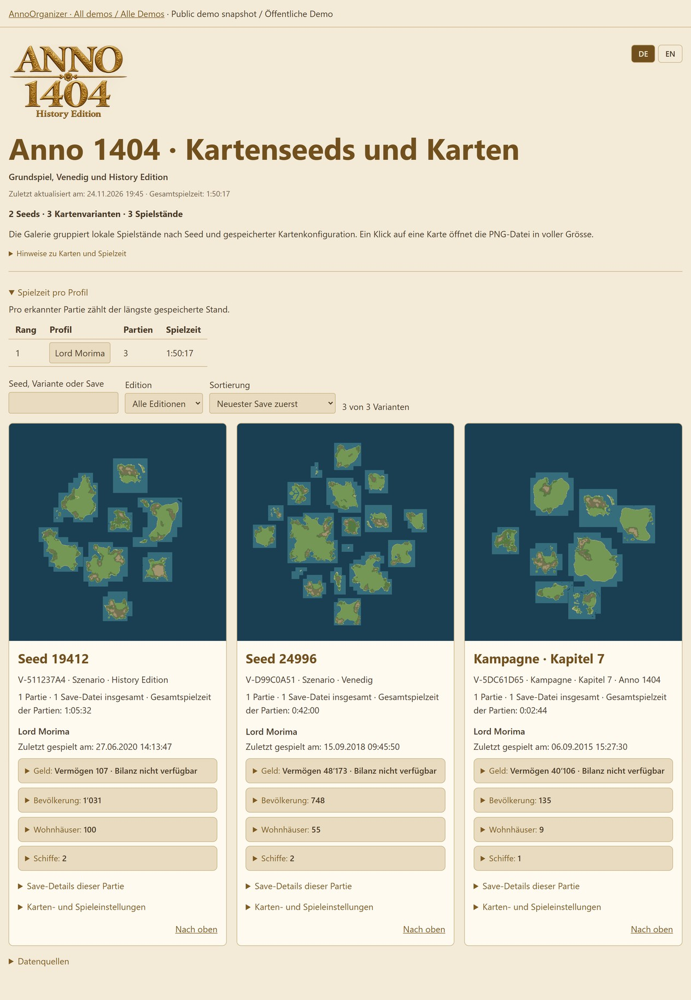

# AnnoTools

[](https://github.com/Morima79/AnnoTools/actions/workflows/tests.yml)
[](https://github.com/Morima79/AnnoTools/releases/latest)
[](https://morima79.github.io/AnnoTools/)

[English](README.md) · [Deutsch](README.de.md) · [Changelog](CHANGELOG.md)

Lokale Windows-Werkzeuge für **Anno 117: Pax Romana**, **Anno 1800** und **Anno 1404** einschliesslich Venedig und History Edition. Sie erstellen HTML-Galerien, Bauplan-PNGs, rekonstruierte Karten und Excel-Auswertungen aus deinen lokalen Dateien. Ein laufendes Spiel oder Codex wird nicht benötigt.

| Funktion | Anno 117 | Anno 1800 | Anno 1404 |
|---|---|---|---|
| Spielstände nach Seed und Kartenvariante auswerten | Ja | Ja | Ja |
| Kartengalerie und Excel-Ausgabe | Ja | Ja | Ja |
| Stempelgalerie mit Bauplan-PNGs | Ja | Ja | Noch nicht implementiert |
| Zusätzliche Stempelfilter | Ceres-Feldgrössen, kosmetische DLCs | DLCs, Traktoren, Silos, Strom, Rathaus, Handelskammer | — |

**Quelldateien werden ausschliesslich gelesen.** Neue Ausgaben liegen standardmässig in `<spiel>/local-data/`. Der Ausgabeordner ist konfigurierbar. Jeder Anno-Ordner ist unabhängig nutzbar und enthält seinen eigenen Starter, Einstellungen, Abhängigkeiten, Anleitungen und Lizenz. Der Hauptstarter bietet zusätzlich ein gemeinsames Auswahlmenü.

## Online-Demos und Releases

[Alle fünf Galerien im Browser ausprobieren](https://morima79.github.io/AnnoTools/) · [Aktuelle Release-ZIP herunterladen](https://github.com/Morima79/AnnoTools/releases/latest)

| Spiel | Kartengalerie | Stempelgalerie |
|---|---|---|
| Anno 117 | [Demo](https://morima79.github.io/AnnoTools/anno117/maps/) | [Demo](https://morima79.github.io/AnnoTools/anno117/stamps/) |
| Anno 1800 | [Demo](https://morima79.github.io/AnnoTools/anno1800/maps/) | [Demo](https://morima79.github.io/AnnoTools/anno1800/stamps/) |
| Anno 1404 | [Demo](https://morima79.github.io/AnnoTools/anno1404/maps/) | — |

Die Online-Demos benötigen keine Installation. Sie sind geprüfte Momentaufnahmen der mitgelieferten Beispiele mit interaktiven Filtern und Bildvorschauen. Die Veröffentlichung erfolgt über GitHub Pages; persönliche Einstellungen und lokale Ausgaben werden nicht hochgeladen.

## Galerie-Vorschau

Echte Screenshots der mitgelieferten Demos. Die Kartengalerien zeigen einheitliche Spieltitel und Kopfzeilen. Ein Klick auf ein Bild öffnet die Aufnahme in voller Auflösung.

### Stempelgalerien

| Anno 117 | Anno 1800 |
|---|---|
| [](anno117/docs/images/stamp-gallery.jpg) | [](anno1800/docs/images/stamp-gallery.jpg) |

### Kartengalerien

| Anno 117 | Anno 1800 | Anno 1404 |
|---|---|---|
| [](anno117/docs/images/map-gallery.jpg) | [](anno1800/docs/images/map-gallery.jpg) | [](anno1404/docs/images/map-gallery.jpg) |

## Schnellstart

1. **Python 3.11 oder neuer** installieren, falls es noch fehlt.
2. Das Repository herunterladen, entpacken und **Launch.cmd** doppelklicken.
3. Eine **Anno-Demo** wählen. Steam-/Ubisoft-Installationen werden nach Möglichkeit automatisch erkannt. Falls das nicht klappt, nur den Installationspfad eingeben. Für die Anno-1404-Demo ist keine Spielinstallation erforderlich.

Der Starter erstellt die lokale Python-Umgebung, installiert beim ersten Start die benötigten Pakete und legt fehlende Einstellungen an. Für diese erste Paketinstallation wird eine Internetverbindung benötigt. Es muss nichts ins Spiel kopiert werden. Nach der Auswertung öffnen sich die Galerien automatisch.

**Allenfalls muss nur der Spielpfad geprüft oder eingegeben werden.** Die Pfade der Demo-Spielstände und -Stempel sind bereits eingerichtet. Sowohl der Installationsordner als auch dessen `maindata`-Unterordner werden akzeptiert. Vorhandene persönliche Einstellungen bleiben erhalten; die Demo verwendet getrennte Eingaben und einen eigenen Ausgabeunterordner.

| Mitgelieferte Beispiele | Spielstände | Stempel |
|---|---:|---:|
| Anno 117 | 3 unterschiedliche Seeds | 5 Layouts, darunter angepasste Städte und Lavendelvarianten |
| Anno 1800 | 3 unterschiedliche Seeds | 5 Layouts aus allen vier Regionen |
| Anno 1404 | 3 Saves: Grundspiel, Venedig, History Edition | Nicht implementiert |

Die Beispiele umfassen zusammen rund **7,4 MB** und wurden aus den Dateien des Projektinhabers kopiert. Ein Demo-Lauf liest nur diese Beispiele und schreibt nach `<eingestellte Ausgabe>/demo/`; persönliche Spielordner werden nicht ausgewertet. Details: [117](anno117/demo/README.de.md), [1800](anno1800/demo/README.de.md), [1404](anno1404/demo/README.de.md).

## Kommandozeile

```powershell
.\.venv\Scripts\python.exe launch.py --game anno117 --action demo
.\.venv\Scripts\python.exe launch.py --game anno1800 --action demo
.\.venv\Scripts\python.exe launch.py --game anno1404 --action demo
```

`--action analyze` erstellt die Karten-/Excel-Auswertung der konfigurierten Eingaben. `--action stamps` erzeugt die Stempelgalerie für 117 und 1800. Vor einer Aktualisierung die bisherige Arbeitsmappe in Excel schliessen. Für eigene Dateien später `account`, `stamps` beziehungsweise `save_folders` in der jeweiligen `settings.json` anpassen. Für den Demo-Einstieg sind diese Änderungen nicht nötig.

Die Installation kann alternativ manuell erfolgen:

```powershell
py -3 -m venv .venv
.\.venv\Scripts\python.exe -m pip install -r requirements.txt
```

## Optionen und Einstellungen

- `--check`: Pfade und Python-Pakete prüfen, ohne Ausgaben anzulegen.
- `--no-open`: aktualisieren, ohne den Browser zu öffnen.
- `--rescan`: bei `--action analyze` den Metadaten-Zwischenspeicher ignorieren.
- `--config PFAD`: eine andere lokale Einstellungsdatei verwenden.
- `--init-settings`: fehlende Einstellungen anlegen; vorhandene erhalten.
- `--help`: alle Kommandozeilenoptionen anzeigen.

Beim regulären Start werden fehlende Einstellungen automatisch angelegt. Jeder Spielordner besitzt eine eigene `settings.json` mit englischen Schlüsseln und Schemaversion 1. `settings.example.json` dient als Vorlage. `${DOCUMENTS}` berücksichtigt den tatsächlichen Windows-Dokumentenordner samt OneDrive-Umleitung; `${HOME}` verweist auf den Benutzerordner. Relative Pfade beziehen sich auf den Ordner der Konfigurationsdatei.

Die technische Benennung und der Code sind Englisch. **Menüs, Meldungen und Galerieoberflächen bleiben vorerst Deutsch.** Ausführliche Anleitungen: [Einstellungen](docs/settings.de.md), [Formate und Grenzen](docs/formats-and-limitations.de.md). Einzelne Werkzeuge: [Anno 117](anno117/README.de.md), [Anno 1800](anno1800/README.de.md), [Anno 1404](anno1404/README.de.md).

## Struktur und Ausgaben

```text
launch.py                 Gemeinsames Auswahlmenü
anno117/                  Eigenständig nutzbare Anno-117-Werkzeuge
anno1800/                 Eigenständig nutzbare Anno-1800-Werkzeuge
anno1404/                 Eigenständig nutzbare Anno-1404-Werkzeuge
  Launch.cmd              Windows-Starter dieses Spiels
  launch.py               Einstiegspunkt dieses Spiels
  settings.example.json   Öffentliche Beispielkonfiguration
  settings.json           Persönliche Einstellungen, von Git ausgeschlossen
  tools/                  Leser, Exporte und HTML-Vorlagen
  demo/                   Beispiel-Saves, Stempel und Dateimanifeste
  local-data/             Erzeugte Ausgaben, von Git ausgeschlossen
tests/                    Automatisierte Regressionstests
docs/                     Ausführliche Dokumentation auf Deutsch
```

Die Galerien liegen unter `stamps/stamp-gallery.html` und `reports/map-gallery.html` im eingestellten Ausgabeordner. Protokolle stehen unter `logs/`. Stempelnamen und Spielordner behalten ihre vorhandenen Bezeichnungen. Alte Ausgaben mit deutschen Dateinamen bleiben erhalten; neue Ausgaben verwenden die englischen Pfade.

## Entwicklung und Veröffentlichung

```powershell
.\.venv\Scripts\python.exe -m unittest discover -s tests -v
```

Der vorbereitete GitHub-Actions-Workflow testet unter Windows mit synthetischen Daten. Nur die ausdrücklich ausgewählten Demo-Saves und Demo-Stempel gehören ins Repository. Andere persönliche Einstellungen, Stempel, Spielstände, Galerien ausserhalb der freigegebenen `site/`-Momentaufnahmen, Spieldaten, Caches und Sicherungen bleiben ausgeschlossen. `.gitignore` berücksichtigt neue und bisherige lokale Dateinamen. Python-Abhängigkeiten werden über pip installiert. Die Spiel-Logos sind zur Kennzeichnung enthalten. Bibliotheks- und Spieldatenarchive werden nicht mitgeliefert.

Inoffizielles Projekt ohne Verbindung zu Ubisoft. Die Ausgaben sind Rekonstruktionen und keine Zusage über Bauplatz, Versorgung, Reichweite oder Spielbetrieb. Der Werkzeugcode steht unter der [MIT-Lizenz](LICENSE).

## Nutzung und Weiterveröffentlichung

Die Verwendung dieser Skripte erfolgt auf eigene Gefahr. Sie werden ohne Gewähr bereitgestellt. Es gilt der Gewährleistungs- und Haftungsausschluss in der [Lizenz](LICENSE).

Bei einer Weiterveröffentlichung der Skripte, auch in geänderter Form, müssen der Urheberhinweis auf **Morima79** samt Verweis auf das [Original-Repository AnnoTools](https://github.com/Morima79/AnnoTools) und die MIT-Lizenzhinweise erhalten bleiben.

## Automatische Veröffentlichung

Release-ZIPs und die Demo-Seite werden über GitHub Actions veröffentlicht. Details zur Release-Erstellung, GitHub-Pages-Einrichtung und Demo-Aktualisierung stehen in der [Veröffentlichungsanleitung](docs/publishing.de.md).
