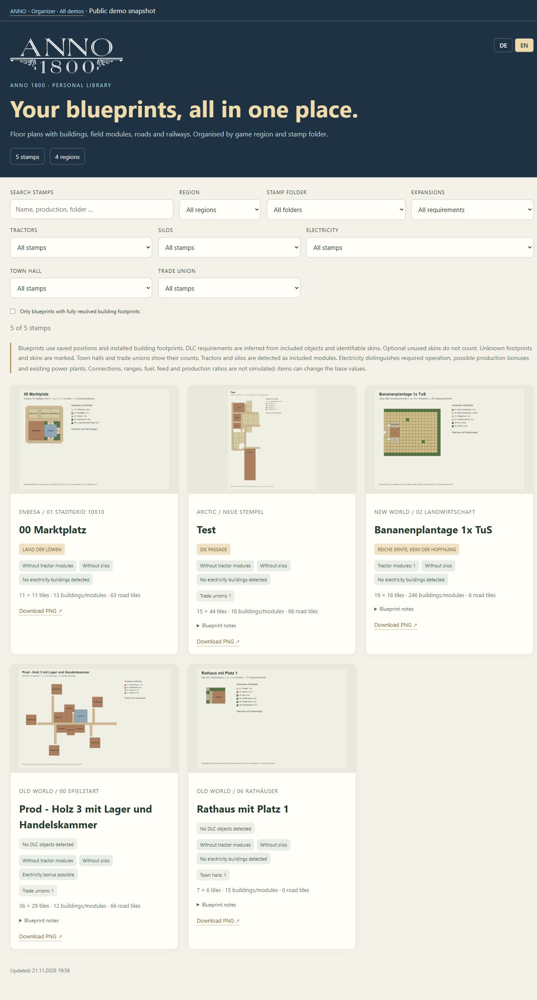
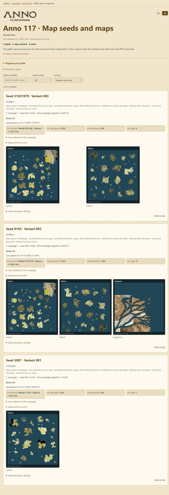
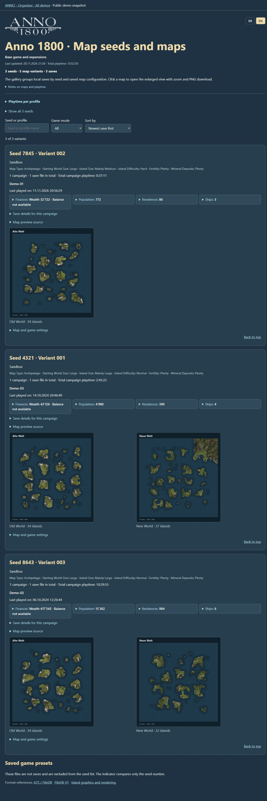
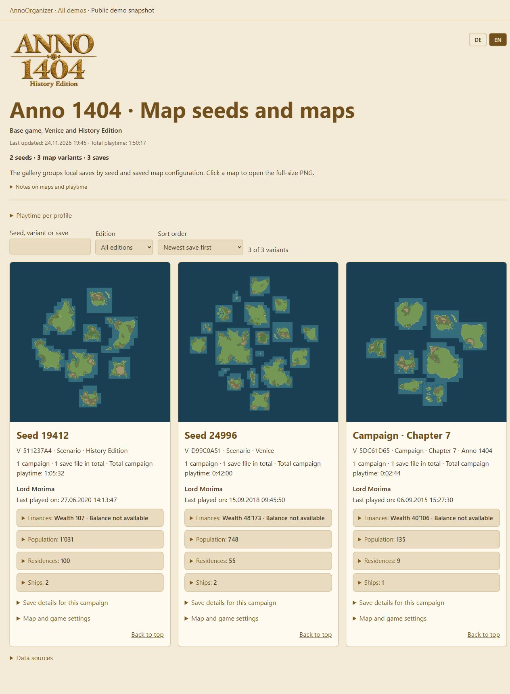

# ANNO - Organizer

[](https://github.com/Morima79/AnnoOrganizer/actions/workflows/tests.yml)
[](https://github.com/Morima79/AnnoOrganizer/releases/latest)
[](https://morima79.github.io/AnnoOrganizer/)

[English](README.md) · [Deutsch](README.de.md) · [Changelog](CHANGELOG.md)

Local Windows tools for **Anno 117: Pax Romana**, **Anno 1800** and **Anno 1404**, including Venice and the History Edition. Build HTML galleries, stamp blueprint PNGs, reconstructed maps and Excel reports from your own local files. Neither a running game nor Codex is required.

| Feature | Anno 117 | Anno 1800 | Anno 1404 |
|---|---|---|---|
| Group saves by seed and map configuration | Yes | Yes | Yes |
| Map gallery and Excel report | Yes | Yes | Yes |
| Stamp gallery and blueprint PNGs | Yes | Yes | Not implemented |
| Additional stamp filters | Ceres field sizes, cosmetic DLCs | DLCs, tractors, silos, electricity, town halls, trade unions | — |

**Source files are read only.** Console output defaults to `<game>/local-data/`; new desktop configurations use `Documents/AnnoOrganizer/Anno <number>/`. The output directory is configurable. Each game folder is independently usable and includes its own launcher, configuration, dependencies, documentation and license. The root launcher provides an optional shared menu.

## Online demos and releases

[Try all five galleries in your browser](https://morima79.github.io/AnnoOrganizer/) · [Download the Windows package (ZIP)](https://github.com/Morima79/AnnoOrganizer/releases/download/v0.1.15/AnnoOrganizer-v0.1.15-windows-x64.zip) · [All releases and source code](https://github.com/Morima79/AnnoOrganizer/releases/latest)

| Game | Map gallery | Stamp gallery |
|---|---|---|
| Anno 117 | [Demo](https://morima79.github.io/AnnoOrganizer/anno117/maps/) | [Demo](https://morima79.github.io/AnnoOrganizer/anno117/stamps/) |
| Anno 1800 | [Demo](https://morima79.github.io/AnnoOrganizer/anno1800/maps/) | [Demo](https://morima79.github.io/AnnoOrganizer/anno1800/stamps/) |
| Anno 1404 | [Demo](https://morima79.github.io/AnnoOrganizer/anno1404/maps/) | — |

The online demos require no installation. They are validated snapshots of the bundled examples, with interactive filters and image previews, published through GitHub Pages. Personal settings and local output are not uploaded.

The demo landing page and galleries share the same **DE/EN switch**. Your saved language choice carries across navigation between these pages when browser storage is available.

Demo Excel downloads (German workbooks): [Anno 117](site/downloads/anno117-map-demo.xlsx) / [ZIP](site/downloads/anno117-map-demo.zip) · [Anno 1800](site/downloads/anno1800-map-demo.xlsx) / [ZIP](site/downloads/anno1800-map-demo.zip) · [Anno 1404](site/downloads/anno1404-map-demo.xlsx) / [ZIP](site/downloads/anno1404-map-demo.zip). The ZIP includes the map images; extract it completely to use the workbook links. Counts and money display as grouped integers; seeds have no grouping. Dates and playtime keep their existing formats.

Map images in all three games open in a dialog with original-size/fit zoom, PNG download and DE/EN controls. Browser Back closes the image and preserves gallery filters; Forward reopens it.

## Gallery previews

The previews show all five bundled demo galleries in English; click an image for full resolution. The German README uses matching German screenshots. Map demos include settled islands, population and residence counts in compact disclosure groups. All galleries use game logos and matching colours; Anno 1404 uses a light parchment theme.

| Gallery | Anno 117 | Anno 1800 | Anno 1404 |
|---|---|---|---|
| Stamps | [](anno117/docs/images/stamp-gallery-en.jpg) | [](anno1800/docs/images/stamp-gallery-en.jpg) | Not implemented |
| Maps | [](anno117/docs/images/map-gallery-en.jpg) | [](anno1800/docs/images/map-gallery-en.jpg) | [](anno1404/docs/images/map-gallery-en.jpg) |

## Quick start: Windows app

1. Download the [Windows x64 package (ZIP)](https://github.com/Morima79/AnnoOrganizer/releases/download/v0.1.15/AnnoOrganizer-v0.1.15-windows-x64.zip) for **Windows 10/11 (64-bit)**.
2. Extract the **entire ZIP** and open **AnnoOrganizer.exe**. Keep `_internal/` beside the executable. No Python installation or installer is needed.
3. Select your game and check the detected installation and standard save/stamp folders. **Maps and Excel** is selected on first launch; press **Generate** to process your own saves. Choose **Stamp gallery** for 117/1800 stamps instead. Close an existing report in Excel before updating it.
4. Open the result with **Open galleries**, or enable **Open galleries after generation**. The adjacent arrow opens one gallery at a time. Your checkbox choice is remembered.

New settings are created automatically under `%LOCALAPPDATA%/AnnoOrganizer/<game>/settings.json`. Output goes to `Documents/AnnoOrganizer/Anno <number>/` under your actual Windows Documents folder, including redirection. Existing settings and output paths are preserved. German Windows display languages select German; all others select English. Your manual **DE/EN** selection is saved.

**Update all galleries** updates all usable games with one click. You do not need all three games: missing games or input folders are skipped and listed in the completion notice. Invalid settings or failed exports still report errors. The package is unsigned; Windows may display a security notice. Release details and SHA-256 checksums are available on the [version page](https://github.com/Morima79/AnnoOrganizer/releases/tag/v0.1.15).

### Try the bundled demo

Select **Bundled demo** explicitly, then press **Generate**. A startup notice identifies the demo and its separate output destination. The demo reads only bundled examples and does not update your personal galleries. Anno 117 and 1800 require installed game resources even for demos; the Anno 1404 demo requires no game installation.

| Bundled examples | Saves | Stamps |
|---|---:|---:|
| Anno 117 | 3 different seeds | 5 layouts, including customised cities and lavender variants |
| Anno 1800 | 3 different seeds | 5 layouts across all four regions |
| Anno 1404 | 3 saves: original, Venice, History Edition | Not implemented |

The sample files total approximately **7.4 MB**. They are copies selected from the project owner's files. A demo run reads only the bundled examples and writes to `<configured output>/demo/`; it does not scan your personal game folders. See [117 examples](anno117/demo/README.md), [1800 examples](anno1800/demo/README.md), [1404 examples](anno1404/demo/README.md).

## Desktop interface

The Windows app provides game selection, editable paths, existing configuration selection/import, saved action choices, progress, cancellation and logs. **Generate** uses the displayed values without saving the personal settings file; use **Save** to retain edited paths. Settings stay outside the extracted application folder, so replacing the application folder preserves them. [Full guide and current limitations](docs/desktop.md).

## Run from source

For the source ZIP or a checkout, install **Python 3.11 or later**, including Tkinter. Double-click **Launch.cmd** for the console menu, or run `Launch.cmd --gui` for the desktop interface. The launcher prepares a local Python environment and installs dependencies on first use; that initial setup needs internet access. Console launchers retain their bundled demo defaults and `<game>/local-data/` output. Each game folder remains independently usable.

## Command-line use

```powershell
.\.venv\Scripts\python.exe launch.py --game anno117 --action demo
.\.venv\Scripts\python.exe launch.py --game anno1800 --action demo
.\.venv\Scripts\python.exe launch.py --game anno1404 --action demo
```

`--action analyze` runs the map/Excel analysis for the configured sources. `--action stamps` builds the configured stamp gallery for 117 and 1800. Close the existing workbook in Excel before updating it. To use your own saves and stamps later, adjust `account`, `stamps` or `save_folders` in that game's `settings.json`. No configuration changes are needed to try the demo.

Manual installation, if preferred:

```powershell
py -3 -m venv .venv
.\.venv\Scripts\python.exe -m pip install -r requirements.txt
```

## Options and settings

The following options apply to the source launchers.

- `--check`: check paths and Python dependencies without creating output.
- `--non-interactive`: require explicit `--game` and `--action`, use an existing configuration, and disable prompts and automatic settings creation. Add `--no-open` to suppress the browser too.
- `--no-open`: update without opening the browser.
- `--rescan`: ignore save-metadata caches when using `--action analyze`.
- `--config PATH`: use a different local settings file.
- `--init-settings`: create missing settings and keep existing settings unchanged.
- `--help`: list command-line options.

Missing console settings are created automatically during a regular launch. Each game uses an English-keyed `settings.json` (schema version 1). Examples are provided as `settings.example.json`. `${DOCUMENTS}` resolves the actual Windows Documents folder, including OneDrive redirection; `${HOME}` resolves the user folder. Relative paths are resolved from the configuration file's directory.

**All five galleries include a DE/EN language switch**, including when opened directly offline. The browser remembers the selection when storage is available. Launcher menus and log messages remain German. Detailed documentation is currently available in German: [Settings](docs/settings.de.md), [Formats and limitations](docs/formats-and-limitations.de.md). See the individual guides for [Anno 117](anno117/README.md), [Anno 1800](anno1800/README.md) and [Anno 1404](anno1404/README.md).

## Project structure

```text
launch.py                 Optional shared launcher
anno117/                  Independent Anno 117 tools
anno1800/                 Independent Anno 1800 tools
anno1404/                 Independent Anno 1404 tools
  Launch.cmd              Windows launcher for that game
  launch.py               Game-specific entry point
  settings.example.json   Public configuration example
  settings.json           Private configuration, ignored by Git
  tools/                  Readers, exporters and HTML templates
  demo/                   Bundled sample saves, stamps and file manifests
  local-data/             Generated output, ignored by Git
tests/                    Synthetic regression tests
desktop/                  Shared desktop interface and settings management
packaging/                Windows package instructions
docs/                     Detailed documentation (English/German)
```

Generated galleries use `stamps/stamp-gallery.html` and `reports/map-gallery.html` beneath the configured output directory. Logs are stored in `logs/`. Stamp names and folders from the game library retain their original names. Existing output using older German filenames is preserved; new output uses the English paths.

## Development

Ideas for future extensions are recorded in the [wishlist](docs/wishlist.md).

```powershell
.\.venv\Scripts\python.exe -m unittest discover -s tests -v
```

The Windows GitHub Actions workflow runs synthetic tests without game data. Only the explicitly listed bundled demo saves and stamps belong in Git. Keep all other private settings, saves, stamps, generated galleries outside the approved `site/` snapshots, game resources, caches and backups excluded. `.gitignore` permits the designated demo paths and excludes private and generated data. Source setup installs Python packages through pip; the Windows package includes its runtime dependencies. Game logos are included for identification. Game resource archives are not bundled.

This is an unofficial project with no affiliation to Ubisoft. Maps and blueprints are reconstructions, not guarantees of placement, supply, range or in-game operation. The tool code is provided under the [MIT license](LICENSE).

## Current save statistics

The map gallery shows each campaign’s latest save with population, wealth, balance, residences and ships. Statistic groups start collapsed; tiers, blueprints and other details appear only when opened. Previous save and playtime information is grouped under **Save details**. Values that cannot be read reliably show **not available**. Excel adds an **Aktuelle Spielstände** worksheet. [Data sources and limitations](docs/save-statistics.md).

## Use and redistribution

Use these scripts at your own risk. They are supplied without warranty. The warranty disclaimer and liability terms in [LICENSE](LICENSE) apply.

When redistributing the scripts, including modified versions, retain the copyright notice naming **Morima79**, its reference to the original [AnnoOrganizer repository](https://github.com/Morima79/AnnoOrganizer), and the MIT license notices.

## Gallery templates

Map and stamp galleries each use a shared page template with colours inspired by each game's interface. Each Anno folder remains independently usable. See the [template guide](docs/gallery-templates.md) for maintenance and synchronisation.

## Automated publishing

Release ZIPs and the demo site are published through GitHub Actions. See the [publishing guide](docs/publishing.md) for release creation, GitHub Pages setup and refreshing the demos.

Save counts and playtime are listed in each campaign’s save details. Map variants show only totals; playtime comparisons stay within one campaign.

Map and game settings use verified DE/EN game labels with contextual value mappings. Unknown values remain explicit. [Original labels and limitations](docs/game-settings.md).
