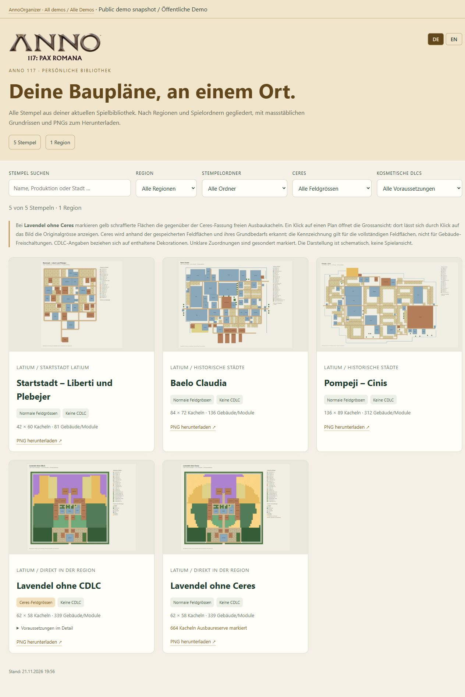
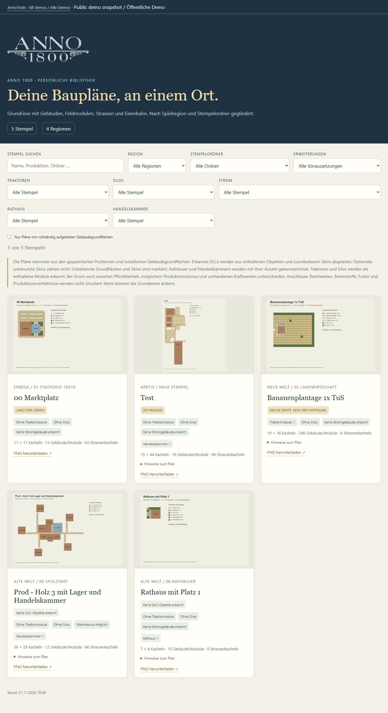
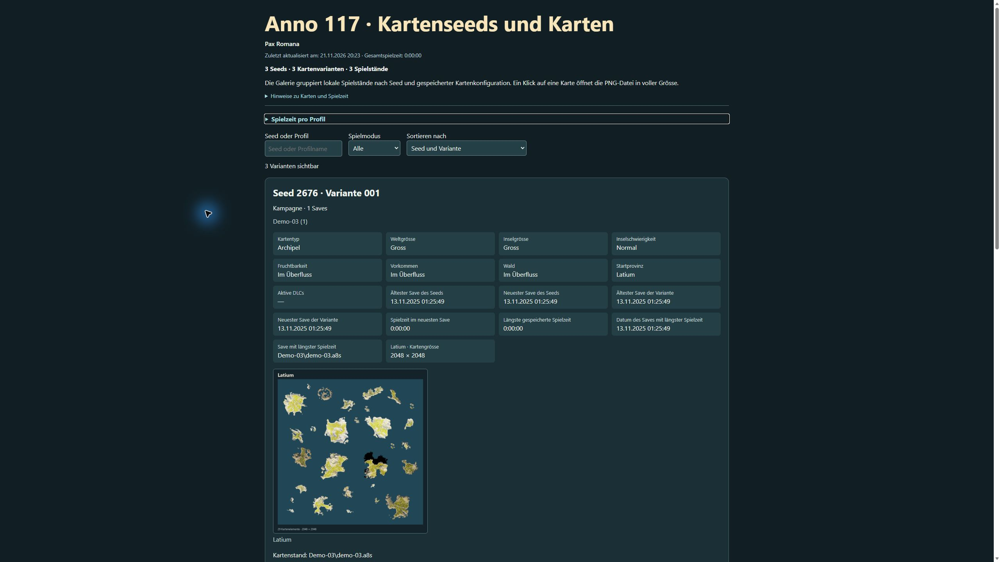
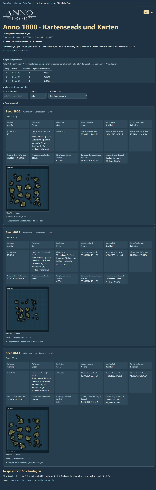
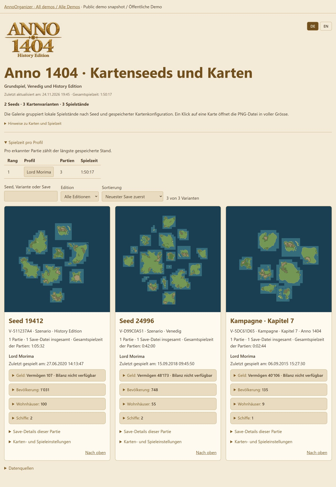

# AnnoTools

[English](README.md) · [Deutsch](README.de.md)

Local Windows tools for **Anno 117: Pax Romana**, **Anno 1800** and **Anno 1404**, including Venice and the History Edition. Build HTML galleries, stamp blueprint PNGs, reconstructed maps and Excel reports from your own local files. Neither a running game nor Codex is required.

| Feature | Anno 117 | Anno 1800 | Anno 1404 |
|---|---|---|---|
| Group saves by seed and map configuration | Yes | Yes | Yes |
| Map gallery and Excel report | Yes | Yes | Yes |
| Stamp gallery and blueprint PNGs | Yes | Yes | Not implemented |
| Additional stamp filters | Ceres field sizes, cosmetic DLCs | DLCs, tractors, silos, electricity, town halls, trade unions | — |

**Source files are read only.** New output defaults to `<game>/local-data/`. The output directory is configurable. Each game folder is independently usable and includes its own launcher, configuration, dependencies, documentation and license. The root launcher provides an optional shared menu.

## Online demos and releases

[Try all five galleries in your browser](https://morima79.github.io/AnnoTools/) · [Download the latest release ZIP](https://github.com/Morima79/AnnoTools/releases/latest)

| Game | Map gallery | Stamp gallery |
|---|---|---|
| Anno 117 | [Demo](https://morima79.github.io/AnnoTools/anno117/maps/) | [Demo](https://morima79.github.io/AnnoTools/anno117/stamps/) |
| Anno 1800 | [Demo](https://morima79.github.io/AnnoTools/anno1800/maps/) | [Demo](https://morima79.github.io/AnnoTools/anno1800/stamps/) |
| Anno 1404 | [Demo](https://morima79.github.io/AnnoTools/anno1404/maps/) | — |

The online demos require no installation. They are validated snapshots of the bundled examples, with interactive filters and image previews, published through GitHub Pages. Personal settings and local output are not uploaded.

## Gallery previews

Actual screenshots of the bundled demos. The map galleries use consistent game titles and summary headers. Click an image to view it at full resolution.

### Stamp galleries

| Anno 117 | Anno 1800 |
|---|---|
| [](anno117/docs/images/stamp-gallery.jpg) | [](anno1800/docs/images/stamp-gallery.jpg) |

### Map galleries

| Anno 117 | Anno 1800 | Anno 1404 |
|---|---|---|
| [](anno117/docs/images/map-gallery.jpg) | [](anno1800/docs/images/map-gallery.jpg) | [](anno1404/docs/images/map-gallery.jpg) |

## Quick start

1. Install **Python 3.11 or later** if it is not already available.
2. Download and extract this repository, then double-click **Launch.cmd**.
3. Select an **Anno demo**. Steam/Ubisoft installations are detected automatically where possible. If detection fails, paste the game's installation path when asked. Anno 1404 does not require an installed game for its demo.

The launcher creates a local Python environment, installs the required packages on first use, and creates missing settings. An internet connection is needed for that initial package installation. No files need to be copied into the game. After processing, the resulting galleries open automatically.

**Only the game installation path may need checking.** Demo save and stamp paths are already configured. Both the installation directory and its `maindata` subdirectory are accepted. Existing personal settings are kept unchanged; the demo uses its own input files and output subdirectory.

| Bundled examples | Saves | Stamps |
|---|---:|---:|
| Anno 117 | 3 different seeds | 5 layouts, including customised cities and lavender variants |
| Anno 1800 | 3 different seeds | 5 layouts across all four regions |
| Anno 1404 | 3 saves: original, Venice, History Edition | Not implemented |

The sample files total approximately **7.4 MB**. They are copies selected from the project owner's files. A demo run reads only the bundled examples and writes to `<configured output>/demo/`; it does not scan your personal game folders. See [117 examples](anno117/demo/README.md), [1800 examples](anno1800/demo/README.md), [1404 examples](anno1404/demo/README.md).

## Command-line use

```powershell
.\.venv\Scripts\python.exe launch.py --game anno117 --action demo
.\.venv\Scripts\python.exe launch.py --game anno1800 --action demo
.\.venv\Scripts\python.exe launch.py --game anno1404 --action demo
```

`--action analyze` runs the map/Excel analysis for the configured sources. `--action stamps` builds the configured stamp gallery for 117 and 1800. Close the existing workbook in Excel before updating it. To use your own saves and stamps later, adjust `account`, `stamps` or `save_folders` in that game's `settings.json`. No configuration changes are needed to try the demo.

Manual installation, if preferred:

```powershell
py -3 -m venv .venv
.\.venv\Scripts\python.exe -m pip install -r requirements.txt
```

## Options and settings

- `--check`: check paths and Python dependencies without creating output.
- `--no-open`: update without opening the browser.
- `--rescan`: ignore save-metadata caches when using `--action analyze`.
- `--config PATH`: use a different local settings file.
- `--init-settings`: create missing settings and keep existing settings unchanged.
- `--help`: list command-line options.

Missing settings are created automatically during a regular launch. Each game uses an English-keyed `settings.json` (schema version 1). Examples are provided as `settings.example.json`. `${DOCUMENTS}` resolves the actual Windows Documents folder, including OneDrive redirection; `${HOME}` resolves the user folder. Relative paths are resolved from the configuration file's directory.

Menus, gallery text and end-user messages currently remain **German**. Detailed documentation is currently available in German: [Settings](docs/settings.de.md), [Formats and limitations](docs/formats-and-limitations.de.md). See the individual guides for [Anno 117](anno117/README.md), [Anno 1800](anno1800/README.md) and [Anno 1404](anno1404/README.md).

## Project structure

```text
launch.py                 Optional shared launcher
anno117/                  Independent Anno 117 tools
anno1800/                 Independent Anno 1800 tools
anno1404/                 Independent Anno 1404 tools
  Launch.cmd              Windows launcher for that game
  launch.py               Game-specific entry point
  settings.example.json   Public configuration example
  settings.json           Private configuration, ignored by Git
  tools/                  Readers, exporters and HTML templates
  demo/                   Bundled sample saves, stamps and file manifests
  local-data/             Generated output, ignored by Git
tests/                    Synthetic regression tests
docs/                     Detailed documentation (German)
```

Generated galleries use `stamps/stamp-gallery.html` and `reports/map-gallery.html` beneath the configured output directory. Logs are stored in `logs/`. Stamp names and folders from the game library retain their original names. Existing output using older German filenames is preserved; new output uses the English paths.

## Development

```powershell
.\.venv\Scripts\python.exe -m unittest discover -s tests -v
```

The Windows GitHub Actions workflow runs synthetic tests without game data. Only the explicitly listed bundled demo saves and stamps belong in Git. Keep all other private settings, saves, stamps, generated galleries outside the approved `site/` snapshots, game resources, caches and backups excluded. `.gitignore` permits the designated demo paths and excludes private and generated data. Python packages are installed through pip; no bundled dependency archives, game logos or graphics are distributed.

This is an unofficial project with no affiliation to Ubisoft. Maps and blueprints are reconstructions, not guarantees of placement, supply, range or in-game operation. The tool code is provided under the [MIT license](LICENSE).

## Use and redistribution

Use these scripts at your own risk. They are supplied without warranty. The warranty disclaimer and liability terms in [LICENSE](LICENSE) apply.

When redistributing the scripts, including modified versions, retain the copyright notice naming **Morima79**, its reference to the original [AnnoTools repository](https://github.com/Morima79/AnnoTools), and the MIT license notices.

## Automated publishing

- **Release ZIP:** Pushing a version tag such as `v0.1.1` starts `.github/workflows/release.yml`. After the Windows tests pass on Python 3.11 and 3.14, it builds `AnnoTools-<version>.zip` and its SHA-256 file from that exact Git snapshot and publishes a GitHub release. Existing releases are not overwritten. `Actions → Release ZIP → Run workflow` creates a downloadable test artifact only, without publishing a release.
- **Website:** Changes to `site/` on `main` are automatically deployed through GitHub Pages after link and local-path validation. The repository needs **GitHub Actions** selected once under `Settings → Pages → Source`.
- **Refreshing demos:** Generate fresh output locally using only the bundled demo inputs. Replace the five `index.html` pages under `site/<game>/maps/` or `stamps/` and only their referenced images. Keep relative image paths, remove absolute local paths, and preserve the links back to the demo landing page. Run `python scripts/validate_site.py` before publishing. Original galleries and personal settings remain unchanged. GitHub does not regenerate these snapshots because some exporters require installed game data.

`site/` contains only HTML and required preview/blueprint images, without game resource archives, caches or private configurations. `scripts/build_release.py` packages tracked files only; local settings and output directories remain excluded.
