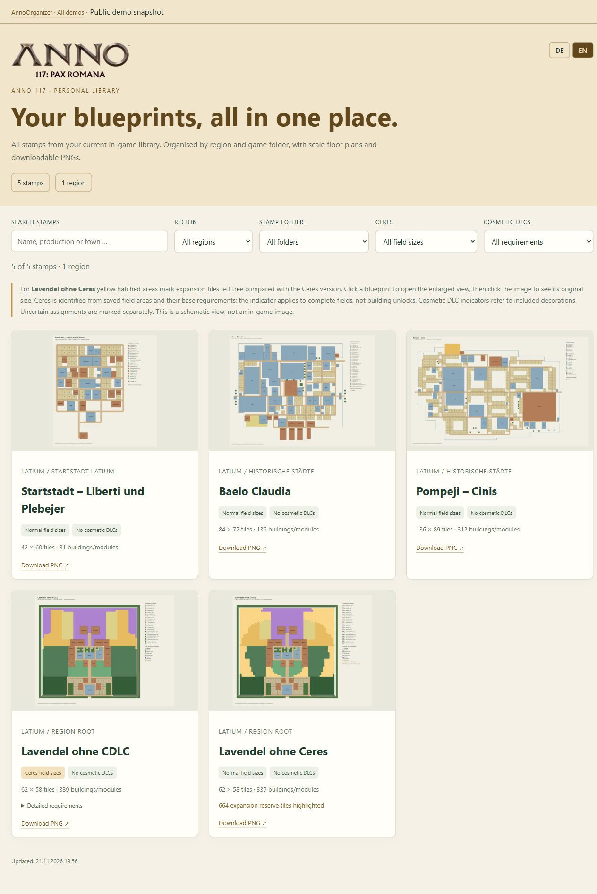
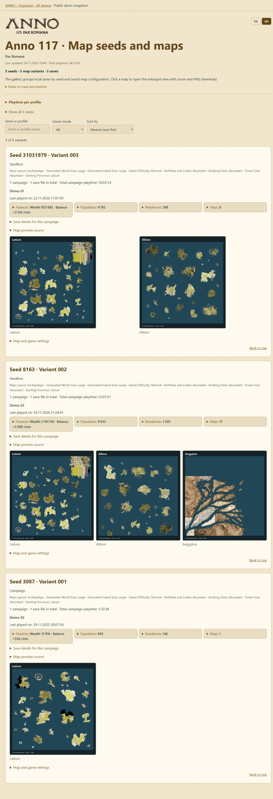

# Anno 117: Pax Romana

[](https://github.com/Morima79/AnnoOrganizer/actions/workflows/tests.yml)
[](https://github.com/Morima79/AnnoOrganizer/releases/latest)
[](https://morima79.github.io/AnnoOrganizer/)

[English](README.md) · [Deutsch](README.de.md)

This folder is independently usable. It includes its own launcher, settings, dependencies and license and does not require the repository's main launcher or the other games. Analysis and gallery tools read source game files only. Menus and log messages remain German; HTML galleries provide a DE/EN switch.

The separate **ANNO - Save Manager** is available as a [standalone Windows package (ZIP)](https://github.com/Morima79/AnnoOrganizer/releases/download/v0.1.21/AnnoSaveManager-v0.1.21-windows-x64.zip): extract the complete ZIP and start `AnnoSaveManager.exe`; Python is not required. It supports Anno 117 and 1800 save copying/moving, complete profile-folder renaming, and praetor/player-name edits in selected saves or every save of a folder. Changes create verified ZIP backups; editing is blocked while the selected game is running. [Illustrated beginner guide](https://morima79.github.io/AnnoOrganizer/save-manager-guide/?lang=en) · [Technical documentation](docs/save-manager.md). From source: `python tools/manage_saves.py`.

## Preview

### Stamp gallery

Five sample layouts, including the two lavender variants and their expansion reserve.

[](docs/images/stamp-gallery-en.jpg)

### Map gallery

Standardised gallery header and Latium island overview with seed, saved map settings and save metadata.

[](docs/images/map-gallery-en.jpg)

[Open the compact map gallery HTML demo](https://morima79.github.io/AnnoOrganizer/anno117/maps/)

Demo Excel: [workbook](https://morima79.github.io/AnnoOrganizer/downloads/anno117-map-demo.xlsx) · [ZIP with map images](https://morima79.github.io/AnnoOrganizer/downloads/anno117-map-demo.zip). Workbooks are in German. Extract the ZIP completely to use the map links. Counts and money use integer display with grouping; seeds have no grouping.

Map images in all three games open in a dialog with original-size/fit zoom, PNG download and DE/EN controls. Browser Back closes the image and preserves gallery filters; Forward reopens it.

## Quick start

Install Python 3.11 or later if needed, then double-click **Launch.cmd** and choose **Demo** (or press Enter). The launcher sets up the Python environment and packages automatically on first use; this requires an internet connection. Missing settings are created automatically.

This folder includes **3 saves and 5 stamps**. The demo uses these files without changing personal settings. For 117 and 1800, the game installation is detected automatically where possible; otherwise only the installation path is requested. Anno 1404 needs no game installation. No manual save/stamp path changes or game imports are needed. Results open in the browser and are written to `<configured output>/demo/`.

[Included examples](demo/README.md). For command-line use after setup:

```powershell
.\.venv\Scripts\python.exe launch.py --action demo
```

## Commands

Build the map gallery and Excel report:

```powershell
.\.venv\Scripts\python.exe launch.py --action analyze
```

Build the stamp gallery:

```powershell
.\.venv\Scripts\python.exe launch.py --action stamps
```

`--non-interactive` requires `--action` and an existing configuration; it disables prompts and automatic settings creation. Add `--no-open` to keep the browser closed.

Use `--check` to validate paths without generating output, `--no-open` to suppress the browser, `--config PATH` for an alternative settings file, or `--rescan` to ignore save-metadata caches during analysis. Close the report in Excel before updating it.

New output defaults to `local-data/` next to this launcher. Gallery files are `reports/map-gallery.html` and, where supported, `stamps/stamp-gallery.html`. Logs are in `logs/` beneath the output directory. Stamp names, custom layouts and source files are not renamed or edited.

Detailed documentation is currently in German: [Settings](docs/settings.de.md), [Formats and limitations](docs/formats-and-limitations.de.md). This is an unofficial project with no affiliation to Ubisoft. Game logos are included for identification and are not covered by the tool code's MIT license; game resource archives are not bundled. Tool code: [MIT license](LICENSE).

Use **DE / EN** at the top right to switch gallery language; all galleries also offer the switch in the image viewer. Search, filters and open views are preserved. The browser remembers your choice when storage is available. Both languages are embedded in the HTML and work offline. Custom names, paths, labels inside PNGs and Excel reports retain their original language.

## Current save statistics

The map gallery shows each campaign’s latest save with population, wealth, balance, residences and ships. Statistic groups start collapsed; tiers, blueprints and other details appear only when opened. Previous save and playtime information is grouped under **Save details**. Values that cannot be read reliably show **not available**. Excel adds an **Aktuelle Spielstände** worksheet. [Data sources and limitations](docs/save-statistics.md).

## Use and redistribution

Use these scripts at your own risk. They are supplied without warranty. The warranty disclaimer and liability terms in [LICENSE](LICENSE) apply.

When redistributing the scripts, including modified versions, retain the copyright notice naming **Morima79**, its reference to the original [AnnoOrganizer repository](https://github.com/Morima79/AnnoOrganizer), and the MIT license notices.

## Online demos

[Map gallery / Kartengalerie](https://morima79.github.io/AnnoOrganizer/anno117/maps/) · [Stamp gallery / Stempelgalerie](https://morima79.github.io/AnnoOrganizer/anno117/stamps/) · [All demos / Alle Demos](https://morima79.github.io/AnnoOrganizer/)

The online galleries show the bundled examples without installation. Automated releases and GitHub Pages are documented in the [publishing guide](../docs/publishing.md).

Save counts and playtime are listed in each campaign’s save details. Map variants show only totals; playtime comparisons stay within one campaign.

Map and game settings use verified DE/EN game labels with contextual value mappings. Unknown values remain explicit. [Original labels and limitations](docs/game-settings.md).
