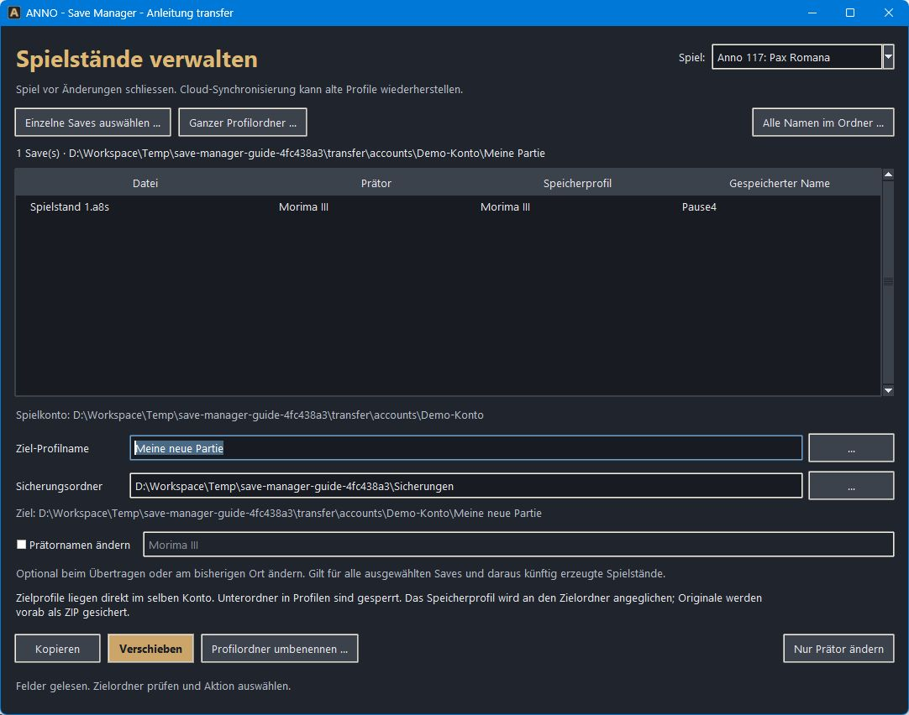
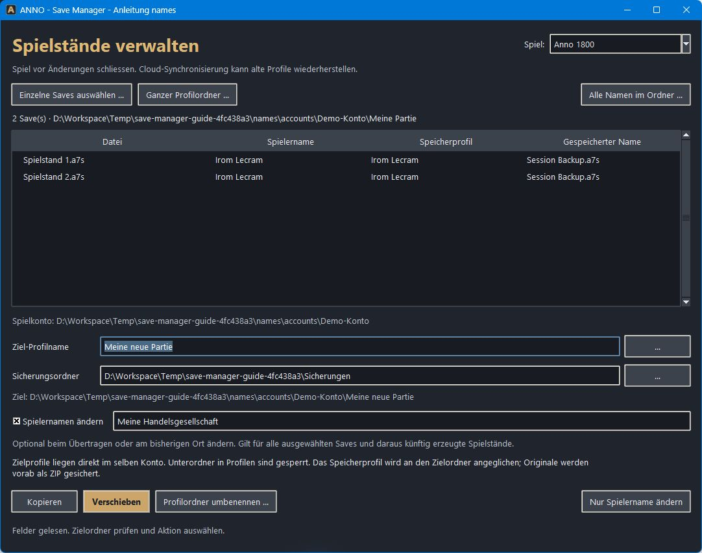

# ANNO - Save Manager: die ersten Schritte

[English](save-manager-guide.md) · [Deutsch](save-manager-guide.de.md) · [Zur Übersicht](../README.de.md)

**Spielstände verschieben, Profilordner umbenennen und Prätor-/Spielernamen ändern – für Anno 117 und Anno 1800.** Die Bilder zeigen isolierte Beispieldaten. Deine Ordner und Namen können anders aussehen. Ein Klick auf ein Bild öffnet es in voller Grösse. Versionen ab v0.1.22 bieten oben rechts **DE / EN** mit gespeicherter Sprachwahl. Die Bilder und Schaltflächennamen dieser Anleitung zeigen **DE**; wähle diese Sprache zum Nachvollziehen. Pakete bis v0.1.21 haben noch die deutsche Oberfläche.

## 1. Herunterladen und vorbereiten

Auf der [Downloadseite](https://github.com/Morima79/AnnoOrganizer/releases/latest) **AnnoSaveManager-<Version>-windows-x64.zip** herunterladen. Im Explorer mit der rechten Maustaste auf die ZIP-Datei klicken und **Alle extrahieren…** wählen. Den vollständigen entpackten Ordner einschliesslich **_internal** behalten und **AnnoSaveManager.exe** öffnen. Python ist nicht nötig. Die Datei **save-manager-guide.html** im Programmpaket öffnet diese Anleitung auch ohne Internet. Fehlt sie in einem älteren Paket, verwende die [Online-Anleitung](https://morima79.github.io/AnnoOrganizer/save-manager-guide/?lang=de).

Vor Änderungen das gewählte Spiel schliessen und eine laufende Cloud-Synchronisierung abwarten. Erkennt der Save Manager einen laufenden Spielprozess, zeigt er eine Meldung und lässt keine Bearbeitung zu. Die Cloud-Synchronisierung erkennt er nicht; sie kann alte Dateien oder Ordner wiederherstellen.

Über **Anleitung** oben im Fenster öffnest du die mitgelieferte Anleitung in der gewählten Sprache, auch ohne Internet. Fehlt die lokale Datei, wird wie beim Organizer die Online-Anleitung verwendet.

## 2. Spiel und Quelle auswählen

Oben rechts **Anno 117: Pax Romana** oder **Anno 1800** wählen. **Einzelne Saves auswählen …** öffnet die Dateiauswahl: einen Save oder mit gedrückter **Strg**-Taste mehrere Saves desselben Profilordners markieren. Anno 117 verwendet **.a8s**, Anno 1800 **.a7s**. Für einen ganzen Ordner stattdessen **Ganzer Profilordner …** wählen.

Ein Profilordner enthält die Saves einer Partie und liegt direkt unter deinem Kontoordner. Der Kontoordner enthält ausser den Profilordnern auch die **accountdata**-Datei. Diese Datei und den Kontoordner selbst nicht als Quelle auswählen. Der Save Manager merkt sich das erkannte Konto pro Spiel; spätere Auswahldialoge starten wieder dort.

Die Tabelle zeigt die ausgewählten Saves und ihre bisherigen Namen. **Ziel-Profilname** ist der Name des Ordners für die Partie. Der **Prätor-/Spielername** bezeichnet deine Figur bzw. Firma. Der **Dateiname** bezeichnet einen einzelnen Save. Diese Namen haben unterschiedliche Aufgaben.

## 3. Einzelne Saves kopieren oder verschieben

Nach der Dateiauswahl bei **Ziel-Profilname** den gewünschten Profilordnernamen eingeben, zum Beispiel **Meine neue Partie**. Über **…** daneben kannst du einen vorhandenen Profilordner desselben Kontos auswählen. Ein neuer Zielordner wird automatisch angelegt. Unter **Ziel** den vollständigen Zielpfad prüfen; bei **Sicherungsordner** steht der Ort für die automatische ZIP-Sicherung.

- **Kopieren:** Die ausgewählten Saves kommen ins Zielprofil; die Quelldateien bleiben erhalten. Das eignet sich zum ersten Ausprobieren.
- **Verschieben:** Die ausgewählten Saves kommen ins Zielprofil und werden nach geprüfter Ausgabe aus dem Quellprofil entfernt. Nicht ausgewählte Saves bleiben dort.

Die gewünschte Schaltfläche anklicken, die Zusammenfassung prüfen und bestätigen. Bestehende Zieldateien werden nicht überschrieben. Bei gleichem Dateinamen ein anderes Ziel wählen oder den Konflikt vorher bewusst im Explorer lösen. Die internen Profilfelder werden passend zum Zielordner gesetzt, damit neue Saves wieder dort landen. Der Dateiname und der interne Name des übertragenen Saves bleiben erhalten.

## 4. Einen ganzen Profilordner umbenennen

**Ganzer Profilordner …** anklicken und den bisherigen Profilordner auswählen. Alle darin enthaltenen Saves erscheinen in der Tabelle. Bei **Ziel-Profilname** den neuen Namen eingeben; der vorausgefüllte Vorschlag **<bisheriger Name> - Neu** ist zum schnellen Ersetzen markiert.

**Profilordner umbenennen …** anklicken, die Zusammenfassung prüfen und bestätigen. Der Name aus dem Feld wird direkt verwendet; ein zweiter Namensdialog ist nicht nötig. Der neue Ordnername muss frei sein. Alle Saves erhalten passende interne Profilfelder. Enthält der Quellordner weitere Dateien oder Unterordner, wird diese Aktion abgelehnt.

**Keine Unterordner anlegen:** Profilordner müssen direkt unter dem Konto liegen. In **Ziel-Profilname** nur einen Namen wie **Meine neue Partie** eingeben, keinen Pfad wie **Sammlung/Meine Partie**. Verschachtelte Profile können im Spiel unsichtbar werden; deshalb sperrt der Save Manager solche Quellen und Ziele.

## 5. Prätor- oder Spielernamen ändern

Für einzelne Saves **Einzelne Saves auswählen …** verwenden. Danach **Prätornamen ändern** (Anno 117) bzw. **Spielernamen ändern** (Anno 1800) anhaken und daneben den neuen Namen eingeben.

Mit **Nur Prätor ändern** bzw. **Nur Spielername ändern** werden die ausgewählten Saves am bisherigen Ort bearbeitet. Der **Ziel-Profilname** wird bei dieser Aktion ignoriert. Wenn du gleichzeitig verschieben, kopieren oder den Profilordner umbenennen möchtest, stattdessen die entsprechende Aktionsschaltfläche verwenden und die Namensänderung angehakt lassen.

## 6. Den Namen in allen Saves eines Ordners ändern

**Alle Namen im Ordner …** anklicken und den Profilordner auswählen. Alle passenden Saves werden geladen und die Namensänderung wird bereits angehakt. Den neuen Namen eingeben, **Nur Prätor ändern** bzw. **Nur Spielername ändern** anklicken und die Zusammenfassung bestätigen.

Der neue Name gilt für alle angezeigten Saves und daraus künftig erzeugte Spielstände. Dateinamen bleiben erhalten. Nicht ausgewählte ältere Saves behalten ihren alten Spielernamen. Bei mehreren oder nicht eindeutig zuordenbaren menschlichen Spielern wird die Namensänderung abgelehnt. Ordner mit Unterordnern werden für diese Auswahl ebenfalls abgelehnt, damit keine versteckten Saves übergangen werden.

## 7. Ergebnis und Sicherung prüfen

Warten, bis die Erfolgsmeldung erscheint. Danach sind Auswahl und Namensfelder für die nächste Aktion geleert. Das Spiel starten, einen bearbeiteten Save laden und das manuelle Speicherfenster öffnen. Prüfen, ob Profil und Prätor-/Spielername stimmen und der neue Save im gewünschten Profil landet. Der Namensvorschlag beim manuellen Speichern richtet sich nach dem Speicherprofil; den einzelnen neuen Save kannst du im Spiel anders benennen.

Vor jeder Bearbeitung entsteht im angezeigten Sicherungsordner eine geprüfte ZIP-Sicherung der ausgewählten Originale mit einem SHA-256-Manifest. Standardmässig liegt sie im Windows-Benutzerordner unter **AppData/Local/AnnoOrganizer/save-backups**. Die Sicherung bleibt auch nach erfolgreicher Bearbeitung erhalten.

Für eine Wiederherstellung Spiel schliessen und Cloud-Synchronisierung beachten. Die passende ZIP anhand von Datum und Manifest auswählen, zunächst in einen separaten Ordner entpacken und die Original-Saves den im Manifest angegebenen Quellpfaden zuordnen. Nach einer Profilumbenennung den ursprünglichen Profilordner bei Bedarf direkt unter dem Konto wieder anlegen. Erst dann die Originale zurückkopieren; vorhandene Dateien vor einem bewussten Ersetzen separat sichern.

| Wenn etwas nicht klappt | Das hilft |
|---|---|
| Das Spiel läuft noch | Das gewählte Spiel vollständig schliessen und die Aktion erneut starten. |
| Unterordner oder ein Pfad im Zielnamen werden abgelehnt | Einen direkten Profilordner unter dem Konto und einen einfachen Zielnamen verwenden. |
| Der Profilordner enthält weitere Dateien | Einzelne Saves auswählen; zum Umbenennen einen Ordner verwenden, der ausschliesslich passende Saves enthält. |
| Der Spielername ist nicht eindeutig | Die Aktion wird zum Schutz der Daten abgelehnt. Den Namen im Spiel ändern. |
| Alte Profile erscheinen wieder | Cloud-Synchronisierung und das zuletzt gespeicherte Profil im Spiel prüfen. |

Weitere Details: [Technische Dokumentation und geprüfte Save-Felder](save-manager.de.md). ANNO - Save Manager gehört zu [AnnoOrganizer von Morima79](https://github.com/Morima79/AnnoOrganizer), MIT-Lizenz; Verwendung auf eigene Gefahr.
