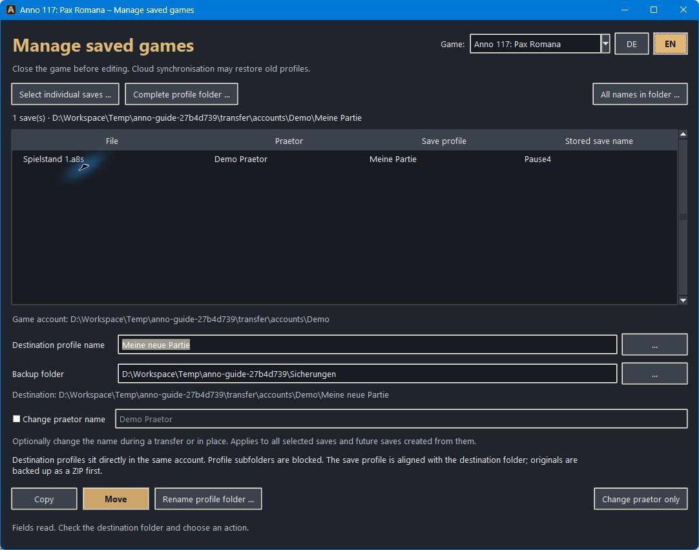
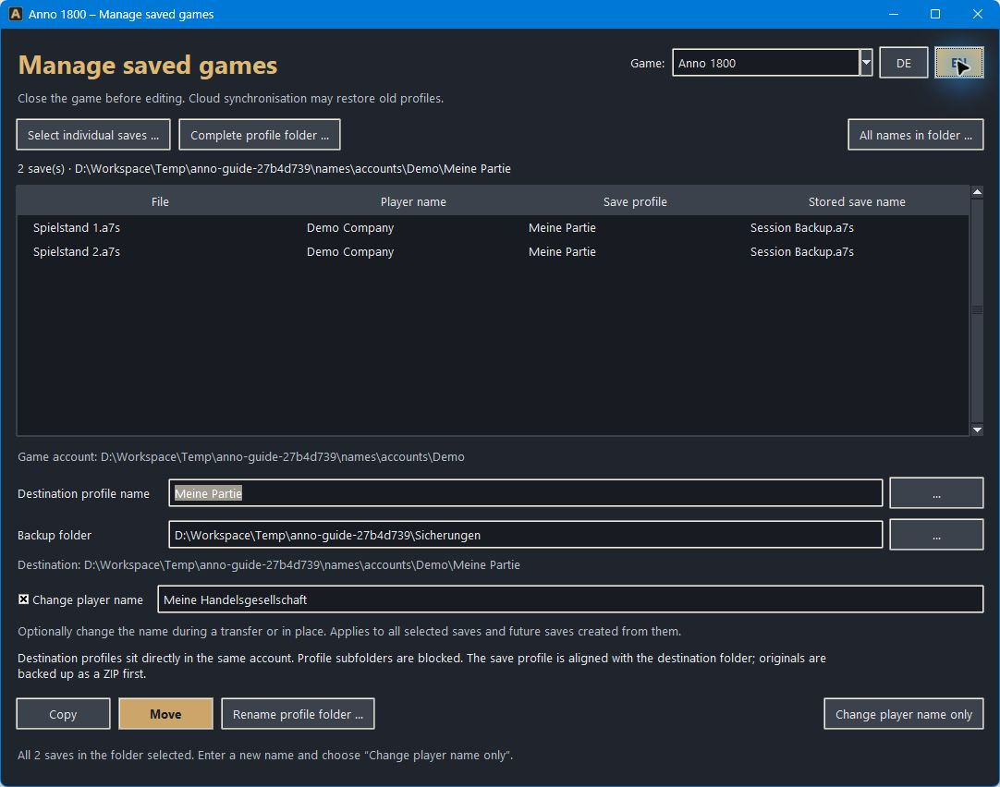

# ANNO - Save Manager: getting started

[English](save-manager-guide.md) · [Deutsch](save-manager-guide.de.md) · [Overview](../README.md)

**Move saves, rename profile folders and change praetor/player names in Anno 117 and Anno 1800.** The screenshots show isolated sample data. Your folders and names may differ. Click an image to open it at full size. The development version provides **DE / EN** at the top right and remembers your choice. Screenshots and button labels in this guide use **EN**; select that language to follow along. Your own folder and player names are not translated. Packages through v0.1.21 still have the German interface.

## 1. Download and prepare

On the [download page](https://github.com/Morima79/AnnoOrganizer/releases/latest), download **AnnoSaveManager-<Version>-windows-x64.zip**. In Explorer, right-click the ZIP and choose **Extract All…**. Keep the complete extracted folder, including **_internal**, and open **AnnoSaveManager.exe**. Python is not required. The **save-manager-guide.html** file in the application package opens this guide offline. If an older package does not include it, use the [online guide](https://morima79.github.io/AnnoOrganizer/save-manager-guide/?lang=en).

Close the selected game and wait for any cloud synchronisation to finish before making changes. If the Save Manager detects a running game process, it displays a message and blocks editing. It does not detect cloud synchronisation, which may restore old files or folders.

## 2. Select the game and source

At the top right, choose **Anno 117: Pax Romana** or **Anno 1800**. Click **Select individual saves …**: select one save, or hold **Ctrl** to select several saves from the same profile folder. Anno 117 uses **.a8s**; Anno 1800 uses **.a7s**. To select a complete folder, use **Complete profile folder …** instead.

A profile folder contains the saves of one playthrough and sits directly inside your account folder. The account folder contains the profile folders and an **accountdata** file. Do not select that file or the account folder itself as the source. The Save Manager remembers the detected account separately for each game; subsequent selection dialogs start there.

The table shows the selected saves and their existing names. **Destination profile name** is the folder name for the playthrough. The **praetor/player name** identifies your character or company. The **filename** identifies an individual save. These names serve different purposes.

## 3. Copy or move individual saves

After selecting files, enter the desired profile folder name in **Destination profile name**, for example **Meine neue Partie**. The adjacent **…** button lets you choose an existing profile folder in the same account. A new destination folder is created automatically. Check the complete destination path under **Destination**; **Backup folder** shows where the automatic ZIP backup will be stored.

- **Copy**: Copies the selected saves into the destination profile and keeps the source files. This is useful for trying the tool first.
- **Move**: Transfers the selected saves and removes their source files after verifying the output. Unselected saves stay in the source profile.

Click the desired button, review the summary and confirm. Existing destination files are never overwritten. If a filename already exists, choose another destination or deliberately resolve the conflict in Explorer first. Internal profile fields are aligned with the destination folder so future saves use it. The transferred save's filename and internal save name remain unchanged.

## 4. Rename a complete profile folder

Click **Complete profile folder …** and select the existing profile folder. All its saves appear in the table. Enter the new name in **Destination profile name**; the suggested **<existing name> - New** is preselected for quick replacement.

Click **Rename profile folder …**, review the summary and confirm. The name already entered is used directly; there is no second naming dialog. The new folder name must be available. Every save receives matching internal profile fields. This action is rejected if the source folder contains extra files or subfolders.

**Do not create subfolders:** Profile folders must sit directly inside the account folder. In **Destination profile name**, enter a simple name such as **Meine neue Partie**, rather than a path such as **Collection/My Playthrough**. Nested profiles may disappear from the game's list, so the Save Manager rejects nested sources and destinations.

## 5. Change a praetor or player name

For individual saves, use **Select individual saves …**. Then tick **Change praetor name** (Anno 117) or **Change player name** (Anno 1800) and enter the new name beside it.

**Change praetor only** or **Change player name only** changes the selected saves in their existing location. **Destination profile name** is ignored for this action. To also move, copy or rename the profile folder, use the corresponding action button instead, keeping the name-change option enabled.

## 6. Change the name in every save in a folder

Click **All names in folder …** and select the profile folder. All matching saves are loaded and the name-change option is enabled automatically. Enter the new name, click **Change praetor only** or **Change player name only**, then review and confirm the summary.

The new name applies to every listed save and future saves created from them. Filenames are preserved. Older saves that were not selected keep their previous player name. Name changes are rejected if several human players exist or the player cannot be identified unambiguously. Folders containing subfolders are also rejected for this selection, preventing hidden saves from being missed.

## 7. Check the result and backup

Wait for the success message. The selection and name fields are then cleared for the next action. Start the game, load an edited save and open the manual save window. Check the profile and praetor/player name and confirm that a new save appears in the intended profile. The manual save-name suggestion follows the save profile; you can give the individual new save a different name in the game.

Before every edit, a verified ZIP backup of the selected originals, including a SHA-256 manifest, is created in the displayed backup folder. By default, this is **AppData/Local/AnnoOrganizer/save-backups** inside your Windows user folder. Backups remain available after successful editing.

To restore a backup, close the game and account for cloud synchronisation. Choose the appropriate ZIP by its date and manifest, extract it into a separate folder first, and match the original saves to the source paths recorded in the manifest. Following a profile rename, recreate the original profile folder directly inside the account if needed. Then copy the originals back; separately preserve existing files before deliberately replacing them.

| If something goes wrong | What to do |
|---|---|
| The game is still running | Close the selected game completely, then retry the action. |
| A subfolder or path in the destination name is rejected | Use a profile folder directly inside the account and a simple destination name. |
| The profile folder contains extra files | Select individual saves; for a folder rename, use a folder containing only matching saves. |
| The player name is ambiguous | Editing is rejected to protect the data. Change the name in the game. |
| Old profiles reappear | Check cloud synchronisation and the game's most recently saved profile. |

Further details: [Technical documentation and verified save fields](save-manager.md). ANNO - Save Manager is part of [AnnoOrganizer by Morima79](https://github.com/Morima79/AnnoOrganizer), MIT licence; use at your own risk.
