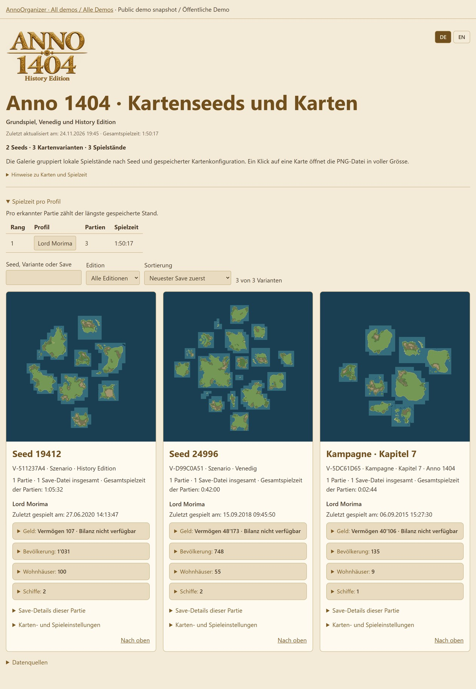

# Anno 1404, Venedig und History Edition

[](https://github.com/Morima79/AnnoTools/actions/workflows/tests.yml)
[](https://github.com/Morima79/AnnoTools/releases/latest)
[](https://morima79.github.io/AnnoTools/)

[English](README.md) · [Deutsch](README.de.md)

Dieser Ordner ist unabhängig nutzbar und enthält seinen eigenen Starter, Einstellungen, Abhängigkeiten und Lizenz. Die anderen Anno-Ordner und der Hauptstarter werden nicht benötigt. Quelldateien werden ausschliesslich gelesen. Die technische Benennung ist Englisch; Menüs, Meldungen und Galerien bleiben Deutsch.

## Vorschau

Einheitlicher Galerie-Kopfbereich und drei Kartenvarianten aus Anno 1404, Venedig und der History Edition.

[](docs/images/map-gallery.jpg)

## Schnellstart

Falls nötig Python 3.11 oder neuer installieren. Danach **Launch.cmd** doppelklicken und **Demo** wählen oder Enter drücken. Die Python-Umgebung und benötigten Pakete werden beim ersten Start automatisch eingerichtet; dafür wird eine Internetverbindung benötigt. Fehlende Einstellungen legt der Starter selbst an.

Dieser Ordner enthält **3 Spielstände und 0 Stempel**. Die Demo verwendet diese Dateien, ohne persönliche Einstellungen zu verändern. Für 117 und 1800 wird die Installation nach Möglichkeit automatisch erkannt; andernfalls wird nur der Spielpfad abgefragt. Für 1404 ist keine Spielinstallation nötig. Save-/Stempelpfade müssen nicht bearbeitet und keine Dateien ins Spiel importiert werden. Die Ergebnisse öffnen sich im Browser und liegen unter `<eingestellte Ausgabe>/demo/`.

[Mitgelieferte Beispiele](demo/README.de.md). Nach der Einrichtung geht auch:

```powershell
.\.venv\Scripts\python.exe launch.py --action demo
```

## Starten

Karten-/Spielstandgalerie mit Excel-Ausgabe:

```powershell
.\.venv\Scripts\python.exe launch.py --action analyze
```

Eine Stempelgalerie ist für Anno 1404 noch nicht implementiert.

`--check` prüft Pfade ohne neue Ausgaben. `--no-open` unterdrückt den Browserstart. `--config PFAD` wählt eine andere Einstellungsdatei. `--rescan` ignoriert den Metadaten-Zwischenspeicher der Spielstandauswertung. Die bestehende Excel-Arbeitsmappe vor dem Aktualisieren schliessen.

Neue Ausgaben liegen standardmässig in `local-data/` neben dem Starter; übernommene Ausgabeordner bleiben erhalten. Die Galeriepfade sind `reports/map-gallery.html` und bei unterstützten Spielen `stamps/stamp-gallery.html`. Protokolle stehen unter `logs/` im Ausgabeordner. Stempelnamen, eigene Layouts und Quelldateien werden nicht umbenannt oder verändert.

- [Einstellungen](docs/settings.de.md)
- [Formate und Grenzen](docs/formats-and-limitations.de.md)
- [MIT-Lizenz](LICENSE)

Inoffizielles Projekt ohne Verbindung zu Ubisoft. Spielgrafiken und Logos werden nicht mitgeliefert; Python-Abhängigkeiten stehen in `requirements.txt`.

## Nutzung und Weiterveröffentlichung

Die Verwendung dieser Skripte erfolgt auf eigene Gefahr. Sie werden ohne Gewähr bereitgestellt. Es gilt der Gewährleistungs- und Haftungsausschluss in der [Lizenz](LICENSE).

Bei einer Weiterveröffentlichung der Skripte, auch in geänderter Form, müssen der Urheberhinweis auf **Morima79** samt Verweis auf das [Original-Repository AnnoTools](https://github.com/Morima79/AnnoTools) und die MIT-Lizenzhinweise erhalten bleiben.

## Online-Demos

[Map gallery / Kartengalerie](https://morima79.github.io/AnnoTools/anno1404/maps/) · [All demos / Alle Demos](https://morima79.github.io/AnnoTools/)

Die Online-Galerien zeigen die mitgelieferten Beispiele ohne Installation. Automatische Releases und GitHub Pages sind in der [Veröffentlichungsanleitung](../docs/publishing.de.md) beschrieben.
