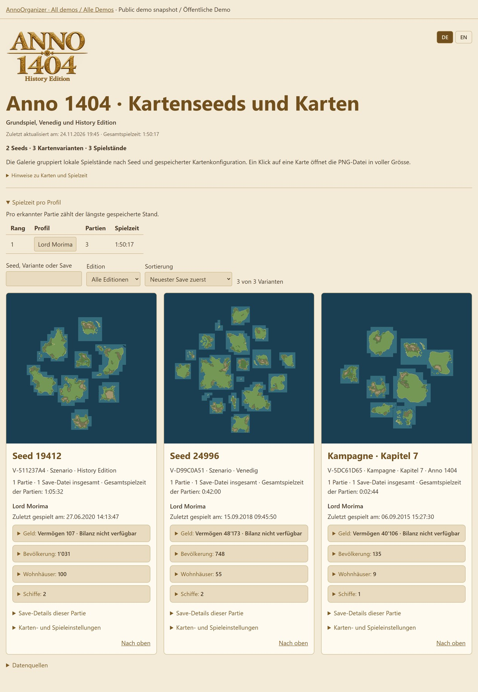

# Anno 1404, Venice and History Edition

[](https://github.com/Morima79/AnnoTools/actions/workflows/tests.yml)
[](https://github.com/Morima79/AnnoTools/releases/latest)
[](https://morima79.github.io/AnnoTools/)

[English](README.md) · [Deutsch](README.de.md)

This folder is independently usable. It includes its own launcher, settings, dependencies and license and does not require the repository's main launcher or the other games. Source game files are read only. Menus, messages and gallery text currently remain German.

## Preview

Standardised gallery header and three map variants from Anno 1404, Venice and the History Edition.

[](docs/images/map-gallery.jpg)

## Quick start

Install Python 3.11 or later if needed, then double-click **Launch.cmd** and choose **Demo** (or press Enter). The launcher sets up the Python environment and packages automatically on first use; this requires an internet connection. Missing settings are created automatically.

This folder includes **3 saves and 0 stamps**. The demo uses these files without changing personal settings. For 117 and 1800, the game installation is detected automatically where possible; otherwise only the installation path is requested. Anno 1404 needs no game installation. No manual save/stamp path changes or game imports are needed. Results open in the browser and are written to `<configured output>/demo/`.

[Included examples](demo/README.md). For command-line use after setup:

```powershell
.\.venv\Scripts\python.exe launch.py --action demo
```

## Commands

Build the map gallery and Excel report:

```powershell
.\.venv\Scripts\python.exe launch.py --action analyze
```

A stamp gallery is not implemented for Anno 1404.

Use `--check` to validate paths without generating output, `--no-open` to suppress the browser, `--config PATH` for an alternative settings file, or `--rescan` to ignore save-metadata caches during analysis. Close the report in Excel before updating it.

New output defaults to `local-data/` next to this launcher. Gallery files are `reports/map-gallery.html` and, where supported, `stamps/stamp-gallery.html`. Logs are in `logs/` beneath the output directory. Stamp names, custom layouts and source files are not renamed or edited.

Detailed documentation is currently in German: [Settings](docs/settings.de.md), [Formats and limitations](docs/formats-and-limitations.de.md). This is an unofficial project with no affiliation to Ubisoft. Game logos are included for identification and are not covered by the tool code's MIT license; game resource archives are not bundled. Tool code: [MIT license](LICENSE).

## Use and redistribution

Use these scripts at your own risk. They are supplied without warranty. The warranty disclaimer and liability terms in [LICENSE](LICENSE) apply.

When redistributing the scripts, including modified versions, retain the copyright notice naming **Morima79**, its reference to the original [AnnoTools repository](https://github.com/Morima79/AnnoTools), and the MIT license notices.

## Online demos

[Map gallery / Kartengalerie](https://morima79.github.io/AnnoTools/anno1404/maps/) · [All demos / Alle Demos](https://morima79.github.io/AnnoTools/)

The online galleries show the bundled examples without installation. Automated releases and GitHub Pages are documented in the [publishing guide](../docs/publishing.md).
