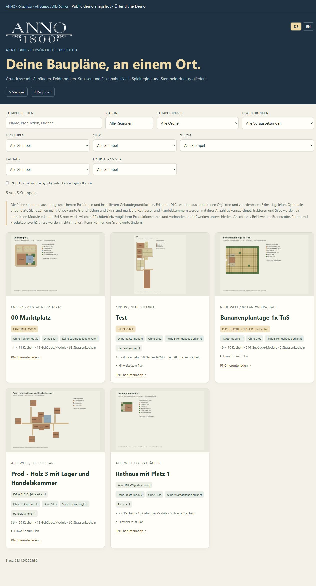
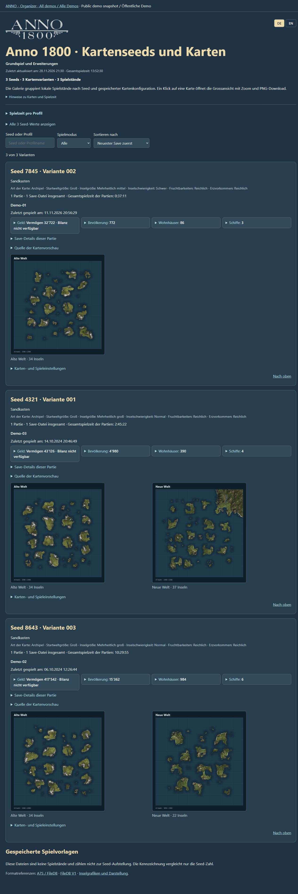

# Anno 1800

[](https://github.com/Morima79/AnnoOrganizer/actions/workflows/tests.yml)
[](https://github.com/Morima79/AnnoOrganizer/releases/latest)
[](https://morima79.github.io/AnnoOrganizer/)

[English](README.md) · [Deutsch](README.de.md)

Dieser Ordner ist unabhängig nutzbar und enthält seinen eigenen Starter, Einstellungen, Abhängigkeiten und Lizenz. Die anderen Anno-Ordner und der Hauptstarter werden nicht benötigt. Analyse- und Galeriewerkzeuge lesen Quelldateien ausschliesslich. Die technische Benennung ist Englisch; Menüs und Protokollmeldungen bleiben Deutsch. Die HTML-Galerien bieten einen DE/EN-Schalter.

Der separate **ANNO - Save Manager** ist als [eigenständiges Windows-Paket (ZIP)](https://github.com/Morima79/AnnoOrganizer/releases/download/v0.1.23/AnnoSaveManager-v0.1.23-windows-x64.zip) verfügbar: vollständig entpacken und `AnnoSaveManager.exe` starten; Python wird dafür nicht benötigt. Er unterstützt Anno 117 und 1800: Saves kopieren oder verschieben, ganze Profilordner umbenennen sowie Prätor-/Spielernamen in einzelnen oder allen Saves eines Ordners ändern. Vor Änderungen entstehen geprüfte ZIP-Sicherungen; bei laufendem Spiel wird die Bearbeitung gesperrt. [Bebilderte Einsteigeranleitung](https://morima79.github.io/AnnoOrganizer/save-manager-guide/?lang=de) · [Technische Dokumentation](docs/save-manager.de.md). Aus dem Quellcode: `python tools/manage_saves.py --game anno1800`.

## Vorschau

### Stempelgalerie

Fünf Beispielbaupläne aus vier Regionen mit Technik- und Verwaltungsfiltern.

[](docs/images/stamp-gallery.jpg)

### Kartengalerie

Einheitlicher Galerie-Kopfbereich und Alte-Welt-Inselübersicht mit Seed, gespeicherten Karteneinstellungen und Angaben zum Spielstand.

[](docs/images/map-gallery.jpg)

[Kompakte Kartengalerie als HTML-Demo öffnen](https://morima79.github.io/AnnoOrganizer/anno1800/maps/)

Demo-Excel: [Arbeitsmappe](https://morima79.github.io/AnnoOrganizer/downloads/anno1800-map-demo.xlsx) · [ZIP mit Kartenbildern](https://morima79.github.io/AnnoOrganizer/downloads/anno1800-map-demo.zip). Die Arbeitsmappen sind auf Deutsch. Für funktionierende Bildlinks das ZIP vollständig entpacken. Kennzahlen und Geld erscheinen als Ganzzahlen mit Tausendertrennzeichen, Seeds ohne Trennzeichen.

Kartenbilder öffnen in allen drei Spielen einen Dialog mit Originalgrösse/Einpassen, PNG-Download und DE/EN-Schalter. Browser-Zurück schliesst das Bild und erhält die Galeriefilter; Vorwärts öffnet es wieder.

## Schnellstart

Falls nötig Python 3.11 oder neuer installieren. Danach **Launch.cmd** doppelklicken und **Demo** wählen oder Enter drücken. Die Python-Umgebung und benötigten Pakete werden beim ersten Start automatisch eingerichtet; dafür wird eine Internetverbindung benötigt. Fehlende Einstellungen legt der Starter selbst an.

Dieser Ordner enthält **3 Spielstände und 5 Stempel**. Die Demo verwendet diese Dateien, ohne persönliche Einstellungen zu verändern. Für 117 und 1800 wird die Installation nach Möglichkeit automatisch erkannt; andernfalls wird nur der Spielpfad abgefragt. Für 1404 ist keine Spielinstallation nötig. Save-/Stempelpfade müssen nicht bearbeitet und keine Dateien ins Spiel importiert werden. Die Ergebnisse öffnen sich im Browser und liegen unter `<eingestellte Ausgabe>/demo/`.

[Mitgelieferte Beispiele](demo/README.de.md). Nach der Einrichtung geht auch:

```powershell
.\.venv\Scripts\python.exe launch.py --action demo
```

## Starten

Karten-/Spielstandgalerie mit Excel-Ausgabe:

```powershell
.\.venv\Scripts\python.exe launch.py --action analyze
```

Stempelgalerie:

```powershell
.\.venv\Scripts\python.exe launch.py --action stamps
```

`--non-interactive` verlangt `--action` und eine vorhandene Konfiguration; Abfragen und automatische Einstellungsanlage entfallen. Mit `--no-open` bleibt auch der Browser geschlossen.

`--check` prüft Pfade ohne neue Ausgaben. `--no-open` unterdrückt den Browserstart. `--config PFAD` wählt eine andere Einstellungsdatei. `--rescan` ignoriert den Metadaten-Zwischenspeicher der Spielstandauswertung. Die bestehende Excel-Arbeitsmappe vor dem Aktualisieren schliessen.

Als Spielkonto kann auch der übergeordnete `accounts`-Ordner gewählt werden. `accountdata*.a7s` sind Kontometadaten und werden in allen Unterordnern von der Spielstandauswertung ausgeschlossen.

Neue Ausgaben liegen standardmässig in `local-data/` neben dem Starter; übernommene Ausgabeordner bleiben erhalten. Die Galeriepfade sind `reports/map-gallery.html` und bei unterstützten Spielen `stamps/stamp-gallery.html`. Protokolle stehen unter `logs/` im Ausgabeordner. Stempelnamen, eigene Layouts und Quelldateien werden nicht umbenannt oder verändert.

- [Einstellungen](docs/settings.de.md)
- [Formate und Grenzen](docs/formats-and-limitations.de.md)
- [MIT-Lizenz](LICENSE)

Inoffizielles Projekt ohne Verbindung zu Ubisoft. Spiel-Logos sind zur Kennzeichnung enthalten und nicht Teil der MIT-Lizenz des Werkzeugcodes; Spieldatenarchive werden nicht mitgeliefert; Python-Abhängigkeiten stehen in `requirements.txt`.

Galerien lassen sich oben rechts mit **DE / EN** umschalten, auch in der Grossansicht. Suche, Filter und offene Ansichten bleiben erhalten. Die Sprachwahl wird nach Möglichkeit im Browser gespeichert. Beide Sprachen sind in der HTML-Datei enthalten und funktionieren offline. Eigene Namen, Dateipfade, Beschriftungen in PNGs und Excel-Auswertungen behalten ihre bisherige Sprache.

## Aktuelle Spielstand-Kennzahlen

Die Kartengalerie zeigt pro Partie den neuesten Save mit Bevölkerung, Vermögen, Bilanz, Wohnhäusern und Schiffen. Jede Kennzahlengruppe bleibt zunächst geschlossen; Stufen, Baupläne und weitere Details erscheinen erst beim Anklicken. Frühere Save- und Spielzeitangaben stehen unter **Save-Details**. Nicht zuverlässig auslesbare Werte werden als **nicht verfügbar** angezeigt. Excel erhält das zusätzliche Blatt **Aktuelle Spielstände**. [Datenquellen und Grenzen](docs/save-statistics.de.md).

## Nutzung und Weiterveröffentlichung

Die Verwendung dieser Skripte erfolgt auf eigene Gefahr. Sie werden ohne Gewähr bereitgestellt. Es gilt der Gewährleistungs- und Haftungsausschluss in der [Lizenz](LICENSE).

Bei einer Weiterveröffentlichung der Skripte, auch in geänderter Form, müssen der Urheberhinweis auf **Morima79** samt Verweis auf das [Original-Repository AnnoOrganizer](https://github.com/Morima79/AnnoOrganizer) und die MIT-Lizenzhinweise erhalten bleiben.

## Online-Demos

[Map gallery / Kartengalerie](https://morima79.github.io/AnnoOrganizer/anno1800/maps/) · [Stamp gallery / Stempelgalerie](https://morima79.github.io/AnnoOrganizer/anno1800/stamps/) · [All demos / Alle Demos](https://morima79.github.io/AnnoOrganizer/)

Die Online-Galerien zeigen die mitgelieferten Beispiele ohne Installation. Automatische Releases und GitHub Pages sind in der [Veröffentlichungsanleitung](../docs/publishing.de.md) beschrieben.

Save-Anzahl und Spielzeitangaben stehen pro Partie in deren Save-Details. Kartenvarianten zeigen nur die Gesamtsummen; Spielzeitvergleiche bleiben innerhalb derselben Partie.

Karten- und Spieleinstellungen verwenden geprüfte DE/EN-Spieltexte und kontextbezogene Wertzuordnungen. Unbekannte Werte bleiben erkennbar. [Originalbezeichnungen und Grenzen](docs/game-settings.de.md).
