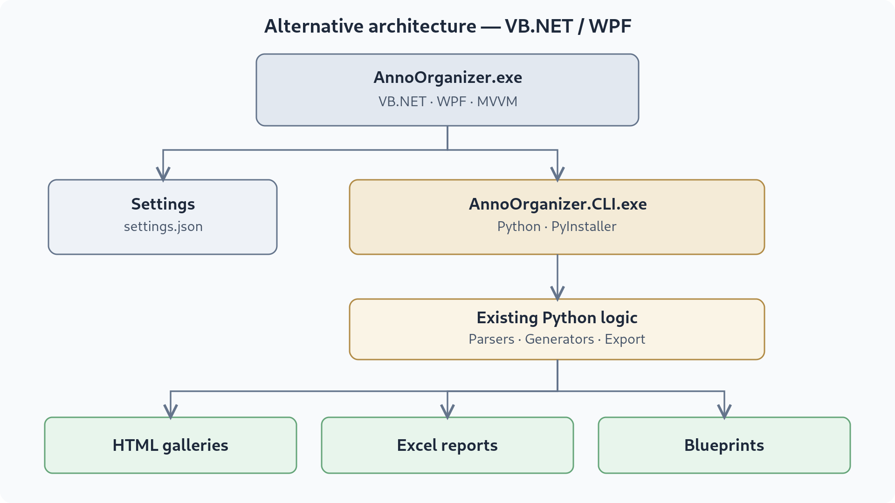
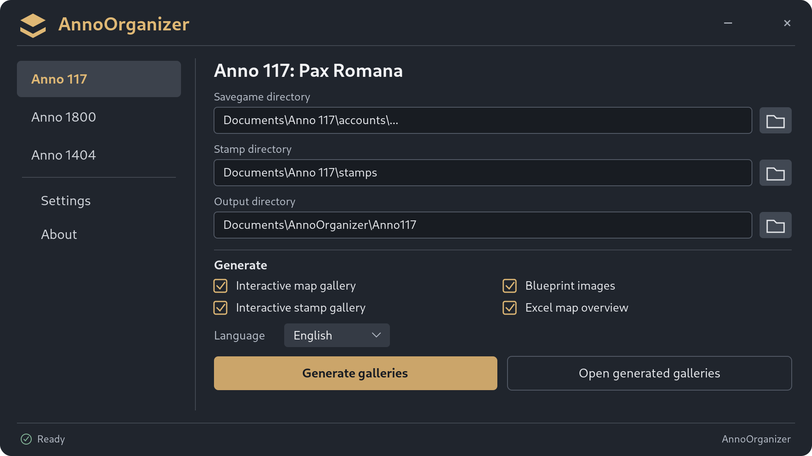

# Vorschlag für eine Desktop-GUI

[English](desktop-gui.md) · [Deutsch](desktop-gui.de.md) · [Wishlist](wishlist.de.md)

Status: Vorschlag; noch nicht implementiert.

## Ziel

Eine portable Windows-Anwendung soll Anno-Spielern ermöglichen, die vorhandenen Werkzeuge ohne Python-Installation, manuelle JSON-Bearbeitung oder Kommandozeile zu konfigurieren und zu starten. Bestehende CLI, eigenständig nutzbare Spielordner und HTML-Galerien bleiben erhalten. Eine erste nutzbare GUI sollte möglichst vor der breiteren Community-Veröffentlichung bereitstehen.

## MVP

- Spielauswahl: Anno 117, Anno 1800 und Anno 1404 inklusive unterstützter Editionen.
- Automatische Erkennung der Spielinstallationen und Benutzerverzeichnisse mit vorhandener Erkennungslogik; manuelle Korrektur ermöglichen.
- Spielspezifische Installations-, Spielstand-/Account-, Stempel- (nur 117/1800) und Ausgabepfade.
- Kartenanalyse/Excel-Berichte oder Stempelgalerie/Blueprints entsprechend den vorhandenen Funktionen auswählen. Keine nicht unterstützten Kombinationen oder noch nicht implementierten unabhängigen Exportoptionen anbieten.
- Mitgelieferte Demos mit getrennten Eingaben/Ausgaben und unveränderten persönlichen Einstellungen starten.
- Konfiguration vor der Verarbeitung prüfen; verständliche Fehlermeldungen und Zugriff auf Logs anbieten.
- Fortschritt, aktuellen Verarbeitungsschritt und Abbruch unterstützen; parallele Verarbeitung desselben Ausgabeziels verhindern.
- Erzeugte Galerien im Standardbrowser und Ausgabeordner öffnen.
- Deutsche und englische Oberfläche, Versionsanzeige und manuelle Release-Prüfung.
- Beim ersten Start die bevorzugte Windows-Anzeigesprache übernehmen: Deutsch für Sprachkennungen mit `de` als Sprachanteil (z. B. `de-DE`, `de-CH`, `de-AT`), sonst Englisch. Falls die Erkennung fehlschlägt, Englisch verwenden. Ein sichtbarer DE/EN-Schalter erlaubt jederzeit eine manuelle Auswahl; diese in `gui.json` speichern und bei späteren Starts vor der Systemsprache bevorzugen. Dafür die Anzeigesprache statt Zahlenformat, Region oder Tastaturlayout auswerten. Die Auswahl betrifft die GUI; bestehende Sprachregeln für HTML-Galerien, Logs und Exporte bleiben erhalten.

## Empfohlene Architektur

Zunächst Python mit Tkinter/ttk und PyInstaller einsetzen. Die GUI bleibt schlank und verwendet die bestehenden Launcher, Parser und Generatoren. Wiederverwendbare Dienste bei Bedarf aus der CLI extrahieren; keine doppelte Verarbeitungslogik oder interaktiven Konsolenabfragen im GUI-Modus. Längere Arbeiten ausserhalb des UI-Threads ausführen und Fortschrittsereignisse an den UI-Thread übergeben. Möglichst kooperativen Abbruch mit sicheren Abbruchpunkten vorsehen und Teilergebnisse kenntlich machen. Bei unbekanntem Gesamtumfang keinen prozentualen Fortschritt vortäuschen.

Alternative: VB.NET/WPF mit .NET 10 LTS und separat paketierter Python-CLI-Engine. Dafür ist ein definierter Prozessvertrag für Argumente, Fortschrittsereignisse, Exitcodes und Abbruch nötig. Erst bei deutlich komplexerer Desktop-Oberfläche erneut bewerten; zwei Laufzeit- und Build-Umgebungen sind für den initialen Umfang nicht erforderlich.

Die folgende Grafik zeigt die VB.NET/WPF-Alternative; die zunächst empfohlene Python-/Tkinter-Architektur ist im Text oben beschrieben.

[Architekturgrafik als SVG](images/desktop-gui-architecture.svg)

## Konfiguration und Daten

Das bestehende spielspezifische settings.json-Schema einschliesslich --config, relativen Pfaden, ${DOCUMENTS} und ${HOME} weiterverwenden. Unbekannte Schlüssel und bestehende Einstellungen erhalten. Pfade validieren, Benutzereinstellungen bei Updates nicht überschreiben und persönliche Einstellungen von paketierten Ressourcen trennen. Konfigurationsort und Importregeln sind unten konkretisiert; CLI-Kompatibilität erhalten. Ausgabepfade bleiben konfigurierbar. Originalspielstände und Stempel niemals verändern. Ressourcen unabhängig vom Arbeitsverzeichnis auflösen; nicht in das interne PyInstaller-Ressourcenverzeichnis schreiben.

## Konkretisierung der drei technischen Punkte

Die folgenden Festlegungen beschreiben den vorgesehenen ersten Implementierungsstand. Sie sind noch nicht umgesetzt; insbesondere bietet die heutige CLI noch keinen strukturierten Fortschritts- oder Abbruchvertrag.

### 1. Ausführung im Quellcode und im Windows-Paket

- Die GUI startet pro Auftrag einen separaten Arbeitsprozess. Im Quellcodebetrieb ist dies ein Python-Worker-Modul; im paketierten Betrieb startet dieselbe EXE mit einem internen `--worker`-Modus, der vor der GUI-Initialisierung ausgewertet wird. `sys.executable` wird im Paket nicht als Python-Interpreter für eine `.py`-Datei verwendet. Ein Auftrag umfasst Spiel, Aktion (`demo`, `analyze`, `stamps`), absoluten Konfigurationspfad und gegebenenfalls `rescan`.
- Der Worker ruft nicht interaktive, spielspezifische Dienste auf. Diese werden aus den bestehenden Einstiegspunkten extrahiert und von GUI und CLI verwendet. Die heutigen Skriptstarts und Konsolenabfragen werden dabei gezielt abgelöst; Parser und Generatoren bleiben die gemeinsame Fachlogik. Jeder Spielordner behält die für seinen Einzelbetrieb erforderlichen Dienste ohne Abhängigkeit vom Hauptordner.
- GUI und Worker tauschen versionierte UTF-8-JSON-Zeilen aus: auf stdout Ereignisse mit `protocol_version`, `run_id`, `type` und Nutzdaten; über stdin einen Abbruchauftrag. Ereignistypen sind `started`, `stage`, `progress`, `diagnostic` und `finished`. Fortschritt enthält nur bei bekanntem Umfang `completed` und `total`. Bestehende Textausgaben gehen ins Log und dürfen den Ereigniskanal nicht verunreinigen; stderr dient unerwarteten Prozessfehlern.
- `finished` enthält den Zustand `success`, `failed` oder `cancelled`, tatsächlich erzeugte Galeriepfade, Logpfad und einen Hinweis auf Teilergebnisse. Exitcodes: `0` Erfolg, `1` Verarbeitungsfehler, `2` ungültiger Auftrag/Konfiguration, `130` Abbruch. Fehlendes oder widersprüchliches Abschlussereignis wird als Fehler behandelt. Die GUI öffnet neue Ergebnisse erst nach bestätigtem Erfolg. Ein Hintergrundleser übergibt Ereignisse per Queue an den Tk-Hauptthread; nur dieser verändert Widgets.
- Der paketierte Worker verwendet ausschliesslich mitgelieferte Module und Ressourcen. Ein Smoke-Test nach dem Entpacken startet alle drei Demos ohne installiertes Python, aus einem anderen Arbeitsverzeichnis und mit den jeweils erforderlichen Spielressourcen.

### 2. Speicherort und Übernahme bestehender Einstellungen

- Die GUI verwaltet je Spiel `%LOCALAPPDATA%/AnnoOrganizer/<game>/settings.json`; reine GUI-Präferenzen liegen getrennt in `%LOCALAPPDATA%/AnnoOrganizer/gui.json`. Den Windows-Ordner über die Betriebssystemauflösung ermitteln und Schreibbarkeit prüfen. «Portabel» bedeutet im MVP ohne Installer startbar; Einstellungen werden nicht automatisch neben der EXE gespeichert. CLI-Standardorte und explizites `--config` bleiben erhalten.
- Bei der Ersteinrichtung kann der Benutzer eine vorhandene Konfiguration **am bisherigen Ort verwenden** oder ausdrücklich **als Kopie importieren**. Die Auswahl zeigt Quellpfad und aufgelöste Eingabe-/Ausgabeziele. Es gibt keine automatische Suche in privaten Spielständen und keine stillschweigende Migration. Eine externe Datei wird nur nach ausdrücklichem Speichern bearbeiteter Einstellungen geändert.
- Beim Kopieren alle bekannten Pfadfelder (`game_data`, `account`, `stamps`, `archive`, `save_folders`, `output`, `report_output`, `stamp_output`, `log_output`) mit derselben Logik wie in `Settings` relativ zur Quelldatei auflösen und relative Angaben als absolute Ziele in die Kopie übernehmen. Auch implizite Standardziele wie `./local-data` müssen erhalten bleiben. Leere optionale Werte bleiben leer; absolute Angaben und Platzhalter können unverändert bleiben, wenn ihre Auflösung am Ziel identisch ist. Unbekannte Schlüssel und Werte unverändert erhalten; unbekannte relative Zeichenfolgen nicht als Pfade interpretieren.
- Für neue GUI-Konfigurationen zeigt `output: ./local-data` auf den Unterordner beim jeweiligen GUI-Konfigurationsort. Die Oberfläche zeigt diesen absoluten Zielpfad vor dem ersten Lauf. Quellcodeinstallationen behalten `<spiel>/local-data/`; importierte Konfigurationen behalten ihre bisherigen Ziele. Neue Demo-Eingaben kommen aus den paketierten Ressourcen, Demo-Ausgaben ausschliesslich nach `<output>/demo/` und ignorieren getrennte persönliche Ausgabeziele.
- Speichern erfolgt nach Validierung über eine eindeutige temporäre Datei im selben Ordner und atomaren Dateiersatz. Vor Änderungen eine Sicherung der bestehenden Konfiguration erstellen und zwischenzeitliche externe Änderungen erkennen; bei Konflikt erneut laden statt überschreiben. Updates ersetzen nur Programmressourcen. Tests müssen direkte externe Nutzung, Import mit relativen/impliziten Pfaden, unbekannte Schlüssel und Neustart/Upgrade abdecken.

### 3. Abbruch, Teilergebnisse und Ausgabesperren

- Der Worker prüft einen kooperativen Abbruch vor jedem Verarbeitungsschritt, zwischen Eingabedateien und vor der Veröffentlichung neuer Ergebnisse. Während nicht unterbrechbarer Parser- oder Bibliotheksaufrufe zeigt die GUI «Abbruch angefordert» bis zum nächsten sicheren Punkt. Für Demos gilt ein Abbruch auch für die noch ausstehenden Aktionen. Im MVP gibt es keinen erzwungenen Prozessabbruch über die Oberfläche; beim Schliessen eines laufenden Fensters Abbruch anfordern und bis zur Bestätigung weiter reagieren.
- Neue Berichte, Galerien und zugehörige Bilder zunächst in einem laufbezogenen temporären Ausgabeordner erzeugen und prüfen. Eine Galerie darf erst auf vollständig veröffentlichte Ressourcen verweisen. Einzeldateien über atomaren Ersatz veröffentlichen; bei mehreren Dateien benötigte Ressourcen vor den HTML-/Excel-Einstiegsdateien bereitstellen und bestehende referenzierte Ressourcen erhalten. Mehrere getrennte Ausgabeordner bilden keine atomare Gesamttransaktion: Eine bereits veröffentlichte Teilausgabe im Abschlussstatus und Log ausdrücklich nennen. Bestehende gültige Ausgaben bei Abbruch vor Veröffentlichung erhalten; nur eigene temporäre Dateien entfernen.
- Die heutige `.annotools.lock` schützt lediglich `settings.output`. GUI und CLI müssen künftig dieselbe prozessübergreifende Sperrverwaltung verwenden und vor dem ersten Schreiben alle tatsächlich verwendeten Ziele reservieren: `output`, aktives Berichts-/Stempelziel, Logziel und beschreibbare Cacheziele. Bei Demos nur die effektiven Demo-Ziele verwenden. Unterschiedliche Konfigurationen mit gemeinsamem `report_output`, `stamp_output` oder `log_output` dürfen die Sperre nicht umgehen.
- Ziele als aufgelöste Windows-Pfade vergleichen, einschliesslich Gross-/Kleinschreibung, kurzer Pfadnamen und Verzeichnisverknüpfungen. Gleiche sowie ineinander verschachtelte Schreibziele zwischen Aufträgen gelten als Konflikt. Reservierungen aller Ziele gemeinsam unter einer benutzerweiten Betriebssystemsperre prüfen und eintragen, damit keine zwei Prozesse gleichzeitig freie Ziele beanspruchen. Eine zweite GUI-Instanz und CLI-Aufrufe müssen dieselben Reservierungen sehen; verwaiste Einträge nur nach bestätigtem Ende des zugehörigen Prozesses entfernen. Sperren bis zum Abschluss der Veröffentlichung und Logausgabe halten und in `finally` freigeben.
- Regressionen: zwei Aufträge mit verschiedenen `output`-Werten, aber gemeinsamem Berichts-/Logziel; verschachtelte oder aliasierte Ziele; Abbruch beim Einlesen und vor der Veröffentlichung; gesperrte Excel-Datei; unerwartetes Worker-Ende; fehlgeschlagene Veröffentlichung nach einer erfolgreichen Demo-Teilaktion. Ein Fehler oder Abbruch darf weder als Gesamterfolg erscheinen noch Originaldaten verändern.

## UI-Konzept

Ein Fenster mit Spielnavigation links und spielspezifischen Pfaden/Aktionen rechts. Einstellungen und Info, Generieren, Abbrechen und Galerien öffnen sowie Fortschritts-/Statusbereich und Logzugriff vorsehen. Nicht relevante Steuerelemente deaktivieren (z. B. Stempel bei Anno 1404). Vorhandene HTML-Galerien beibehalten, keinen Desktop-Galerieviewer nachbauen.

Der visuelle Entwurf zeigt die geplante Spielnavigation, Pfadauswahl und Ausgabeaktionen mit englischen Beispieltexten. Die dargestellten Pfade und einzelnen Export-Checkboxen sind illustrative Beispiele; für Standardpfade und verfügbare Aktionskombinationen gelten die Festlegungen dieses Vorschlags.

[GUI-Entwurf als SVG](images/desktop-gui-concept.svg)

## Bereitstellung

Zunächst PyInstaller im onedir- und --windowed-Modus verwenden und als portables Windows-ZIP über GitHub Releases bereitstellen. Windows-Build in bestehende Release-Pipeline integrieren oder separaten Workflow anlegen. Erforderliche Templates, Demodateien und Laufzeitabhängigkeiten mitliefern, Lizenzhinweise erhalten und Drittanbieter-Lizenzen dokumentieren. Keine Spielressourcenarchive oder persönlichen Daten paketieren. Keine pip-Installation zur Laufzeit. Bestehendes Quellcode-Paket weiterhin bereitstellen. Ressourcenauflösung und Abhängigkeiten im paketierten Build prüfen; onefile erst später erwägen. SHA-256-Prüfsummen veröffentlichen, mögliche SmartScreen-Warnungen bei unsignierten EXE-Dateien erklären und Signierung separat bewerten. Keine Umgehung von Sicherheitsmechanismen empfehlen. Installer, automatische Updates und integrierter Browser gehören nicht zum MVP.

## Abnahmekriterien

- [ ] Auf einem frischen unterstützten Windows-System ohne Python lässt sich die Anwendung entpacken und starten.
- [ ] Pfade aller drei Spiele werden erkannt oder manuell konfiguriert; Einstellungen bleiben bei Neustart und Upgrade erhalten.
- [ ] Bestehende CLI und eigenständige Spielordner funktionieren weiterhin; Regressionstests bestehen.
- [ ] Alle fünf unterstützten Demo-Galerien funktionieren unter den bestehenden Spielressourcen-Voraussetzungen; Demos durchsuchen keine persönlichen Dateien.
- [ ] Persönliche Karten-/Excel- und unterstützte Stempelausgaben entsprechen bei gleichen Eingaben dem CLI-Verhalten.
- [ ] Pfade mit Leerzeichen, Unicode und umgeleitetem Dokumente-Ordner funktionieren; ungültige Pfade und gesperrte Excel-Dateien erzeugen verständliche Meldungen.
- [ ] GUI bleibt bedienbar; Abbruch und Fehler werden korrekt angezeigt, ohne falsche Erfolgsmeldungen oder beschädigte Quelldateien.
- [ ] Logs und Ausgaben lassen sich öffnen; deutsche und englische Oberfläche funktionieren.
- [ ] Release-ZIP ist über CI reproduzierbar, enthält erforderliche Ressourcen und Lizenzen und wird nach dem Entpacken getestet.

## Umsetzungsschritte

1. Launcher- und Konfigurationsschnittstellen prüfen; nicht interaktiven Ausführungs- und Fortschrittsvertrag definieren.
2. GUI und Einstellungsverwaltung implementieren; Pfad- und Konfigurationskompatibilität testen.
3. Hintergrundverarbeitung, Abbruch, Logging und Ausgabe-Navigation ergänzen.
4. Windows-Paket erstellen und testen; Publishing-Workflow und Schnellstart-Dokumentation ergänzen.
5. Auf einem sauberen Windows-System abnehmen und Community-Beitrag mit Screenshots, Demo- und Release-Link vorbereiten.

Dieser Vorschlag legt weder einen verbindlichen Release-Termin noch eine endgültige Technologieentscheidung fest.
