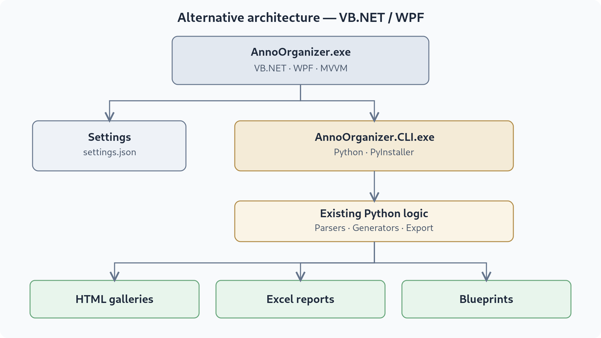
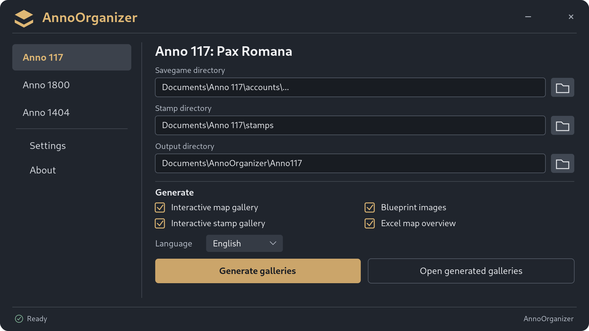

# Desktop GUI proposal

[English](desktop-gui.md) · [Deutsch](desktop-gui.de.md) · [Wishlist](wishlist.md)

Status: Proposed; not implemented.

## Goal

Provide a portable Windows application that lets Anno players configure and run the existing tools without installing Python, editing JSON manually or using a command prompt. Preserve the existing CLI, standalone game folders and browser-based galleries. Aim to deliver the first usable GUI before broader community promotion.

## MVP

- Game navigation: Anno 117, Anno 1800 and Anno 1404 (including supported editions).
- Detect game installations and user directories using existing detection logic; allow manual overrides.
- Configure installation, save/account, stamp (117/1800 only) and output paths as applicable.
- Select map analysis/Excel reports or stamp gallery/blueprints according to existing capabilities. Do not advertise unsupported combinations or independent export switches unless implemented.
- Run bundled demos with isolated input/output and without changing personal settings.
- Validate configuration before processing; show clear diagnostics and offer to open logs.
- Show progress, current operation and cancellation; prevent concurrent runs against the same output.
- Open generated galleries in the default browser and open the output folder.
- German/English GUI, version information and manual release check.
- On first launch, use the preferred Windows display language: German for language identifiers whose language component is `de` (e.g. `de-DE`, `de-CH`, `de-AT`), otherwise English. Fall back to English if detection fails. A visible DE/EN control allows manual selection at any time; save it in `gui.json` and prefer it over the system language on subsequent launches. Detect the display language rather than number formatting, region or keyboard layout. This selection applies to the GUI; existing language rules for HTML galleries, logs and exports remain in place.

## Recommended architecture

Use Python with Tkinter/ttk and PyInstaller initially. Keep the GUI thin and reuse the existing root and game-specific launchers, parsers and generators. Extract reusable services from CLI code where required; avoid duplicate processing and interactive console prompts in GUI mode. Execute long-running work outside the UI thread and marshal progress events to the UI thread. Use cooperative cancellation where possible; define safe cancellation boundaries and report partial output. Do not simulate determinate progress when totals are unknown.

Alternative: VB.NET/WPF on .NET 10 LTS with a packaged Python CLI engine. A structured process contract (arguments, progress events, exit codes and cancellation) would be required. Reconsider only if the desktop UI becomes substantially more complex; two runtimes and build stacks are unnecessary for the initial scope.

The following diagram shows the VB.NET/WPF alternative; the initially recommended Python/Tkinter architecture is described above.

[Architecture diagram as SVG](images/desktop-gui-architecture.svg)

## Configuration and data

Reuse the current per-game settings.json schema and semantics, including --config, relative paths, ${DOCUMENTS} and ${HOME}. Preserve unknown keys and existing settings. Validate paths, avoid overwriting user settings on upgrades, and keep personal settings separate from bundled resources. The configuration location and import rules are detailed below; retain existing CLI compatibility. Keep outputs configurable, and never modify original saves or stamps. Resolve bundled resources independently of the working directory and do not write into PyInstaller's internal resource directory.

## Details of the three technical decisions

The following decisions describe the intended initial implementation. They are not implemented yet; in particular, the current CLI does not provide a structured progress or cancellation contract.

### 1. Execution from source and in the Windows package

- The GUI starts a separate worker process for each job. Source installations use a Python worker module; the packaged application starts the same executable with an internal `--worker` mode handled before GUI initialization. The package must not use `sys.executable` as a Python interpreter for a `.py` file. A job specifies the game, action (`demo`, `analyze`, `stamps`), absolute configuration path and optional `rescan`.
- The worker calls non-interactive, game-specific services extracted from existing entry points and shared by GUI and CLI. Replace the current script launches and console prompts deliberately; parsers and generators remain the shared domain logic. Each game folder retains the services required for standalone operation without depending on the repository root.
- GUI and worker exchange versioned UTF-8 JSON lines: stdout carries events with `protocol_version`, `run_id`, `type` and payload; stdin accepts a cancellation request. Event types are `started`, `stage`, `progress`, `diagnostic` and `finished`. Progress includes `completed` and `total` only when totals are known. Existing text output goes to the log and must not pollute the event channel; stderr carries unexpected process errors.
- `finished` includes status `success`, `failed` or `cancelled`, actual generated gallery paths, the log path and partial-output information. Exit codes: `0` success, `1` processing failure, `2` invalid job/configuration, `130` cancellation. A missing or contradictory completion event is a failure. The GUI opens new results only after confirmed success. A background reader queues events for the Tk main thread; only that thread updates widgets.
- The packaged worker uses only bundled modules and resources. After extraction, a smoke test runs all three demos without installed Python, from a different working directory and with the required game resources.

### 2. Settings location and reuse of existing configurations

- The GUI manages `%LOCALAPPDATA%/AnnoOrganizer/<game>/settings.json` per game; GUI-only preferences live separately in `%LOCALAPPDATA%/AnnoOrganizer/gui.json`. Resolve the Windows folder through the operating system and check write access. In the MVP, portable means launchable without an installer; settings are not automatically stored beside the executable. CLI defaults and explicit `--config` remain supported.
- During setup, users can **use an existing configuration in place** or explicitly **import a copy**. Show the source path and resolved input/output destinations. Do not automatically search personal saves or silently migrate settings. An external file changes only when the user explicitly saves edited settings.
- When copying, resolve all known path fields (`game_data`, `account`, `stamps`, `archive`, `save_folders`, `output`, `report_output`, `stamp_output`, `log_output`) relative to the source file using the same logic as `Settings`, and store relative entries as absolute destinations in the copy. Preserve implicit default destinations such as `./local-data` too. Empty optional values stay empty; absolute entries and placeholders may remain unchanged if they resolve identically at the destination. Preserve unknown keys and values unchanged; do not interpret unknown relative strings as paths.
- New GUI configurations use `output: ./local-data` beneath the respective GUI configuration directory. Show the absolute destination before the first run. Source installations retain `<game>/local-data/`; imported configurations retain their existing destinations. New demo inputs come from bundled resources; demo outputs stay entirely under `<output>/demo/` and ignore separate personal output destinations.
- Save validated settings through a unique temporary file in the same directory and atomic replacement. Back up an existing configuration before changing it and detect intervening external edits; reload on conflict instead of overwriting. Upgrades replace program resources only. Tests must cover direct external use, import with relative/implicit paths, unknown keys and restart/upgrade persistence.

### 3. Cancellation, partial results and output locking

- The worker checks cooperative cancellation before each stage, between input files and before publishing new results. During non-interruptible parser or library calls, the GUI displays “Cancellation requested” until the next safe boundary. Cancelling a demo also cancels its remaining actions. The MVP offers no forced process termination in the UI; closing an active window requests cancellation and remains responsive until acknowledgement.
- Generate and validate new reports, galleries and related images in a run-specific temporary output directory first. A gallery must only reference fully published resources. Publish individual files through atomic replacement; for multiple files, publish required resources before HTML/Excel entry points and preserve existing referenced resources. Separate output directories do not form an atomic transaction: explicitly report any already published partial output in the completion status and log. Preserve existing valid outputs when cancellation precedes publication; remove only the job's own temporary files.
- The current `.annotools.lock` protects only `settings.output`. GUI and CLI must share a cross-process locking mechanism and reserve every actual destination before writing: `output`, the active report/stamp destination, the log destination and writable cache destinations. Demos use effective demo destinations only. Different configurations sharing `report_output`, `stamp_output` or `log_output` must not bypass locking.
- Compare resolved Windows paths, accounting for case, short names and directory links. Equal or nested write destinations across jobs are conflicts. Check and register all destinations together under a per-user operating-system lock so two processes cannot claim free destinations simultaneously. A second GUI instance and CLI calls must observe the same reservations; remove stale entries only after confirming the owning process has ended. Hold reservations through publication and final logging, and release them in `finally`.
- Regressions: jobs with different `output` values but a shared report/log destination; nested or aliased destinations; cancellation during input and before publication; a locked Excel file; unexpected worker exit; publication failure after a successful demo action. Failure or cancellation must never appear as overall success or modify original data.

## UI concept

A single window with game navigation on the left and game-specific paths/actions on the right. Provide Settings and About, Generate, Cancel and Open galleries actions, a progress/status area and access to logs. Disable irrelevant controls, e.g. stamps for Anno 1404. Use the existing HTML galleries rather than implementing a desktop gallery viewer.

The visual concept shows the proposed game navigation, path selection and output actions with English example text. The displayed paths and individual export checkboxes are illustrative examples; the decisions in this proposal define default paths and available action combinations.

[GUI concept as SVG](images/desktop-gui-concept.svg)

## Distribution

Initially use PyInstaller onedir and --windowed, distributed as a portable Windows ZIP via GitHub Releases. Build on Windows in the existing release workflow (or a dedicated workflow), package required templates, demo files and runtime dependencies, preserve license notices and include third-party notices. No game resource archives or personal data. No runtime pip installation. Keep the existing source distribution available. Verify resource resolution and dependency inclusion in the frozen build; consider onefile only later. Publish SHA-256 checksums; explain possible SmartScreen warnings for unsigned binaries, and evaluate signing separately. Do not advise bypassing security controls. No installer, automatic updates or embedded browser in MVP.

## Acceptance checklist

- [ ] Fresh supported Windows machine without Python: extract and launch successfully.
- [ ] All three game paths can be detected or configured manually; settings survive restart and upgrade.
- [ ] Existing CLI and standalone game folders remain functional; existing regression tests pass.
- [ ] All five supported demo galleries work subject to existing game-resource prerequisites; demo does not scan personal files.
- [ ] Personal map/Excel and supported stamp outputs match CLI behavior on equivalent inputs.
- [ ] Paths containing spaces, Unicode and redirected Documents work; invalid paths and locked Excel workbooks produce actionable messages.
- [ ] UI remains responsive; cancellation and failures are reported without falsely claiming success or damaging source files.
- [ ] Logs and generated outputs can be opened; German and English UI work.
- [ ] Release ZIP is reproducible through CI, includes required resources and licenses, and is smoke-tested after extraction.

## Implementation sequence

1. Inspect launcher/configuration APIs and define reusable non-interactive execution/progress contracts.
2. Implement GUI and settings handling, with tests for path and settings compatibility.
3. Add worker execution, cancellation, logging and output navigation.
4. Package and test frozen Windows build; extend publishing workflow and quick-start documentation.
5. Validate on a clean Windows environment and prepare community announcement with screenshots, demo link and release link.

This is a proposal, not a commitment to a release date or implementation technology.
