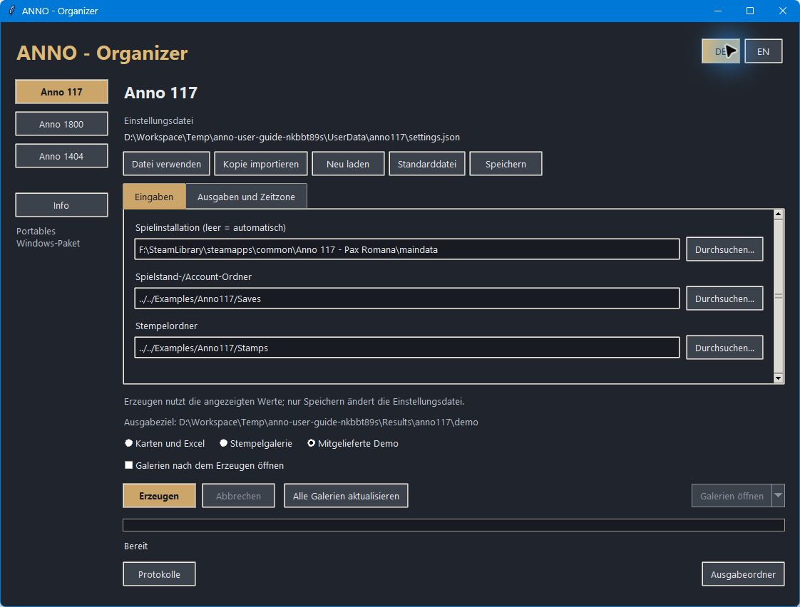
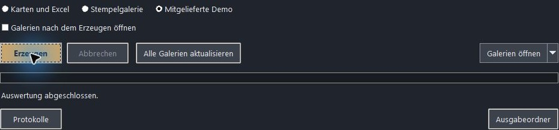
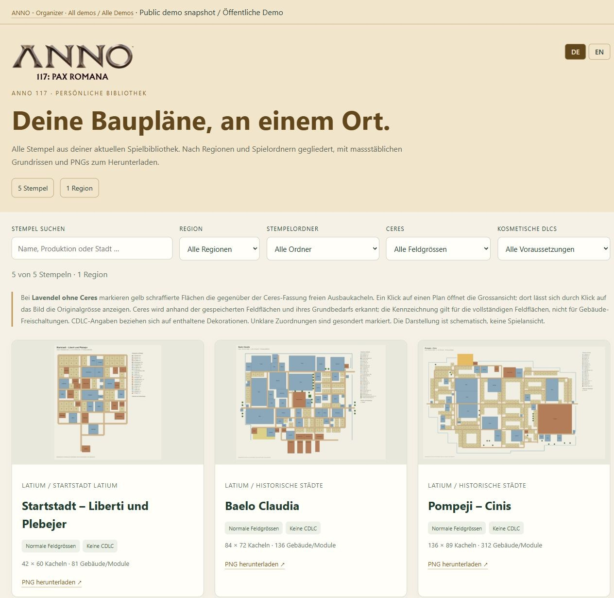
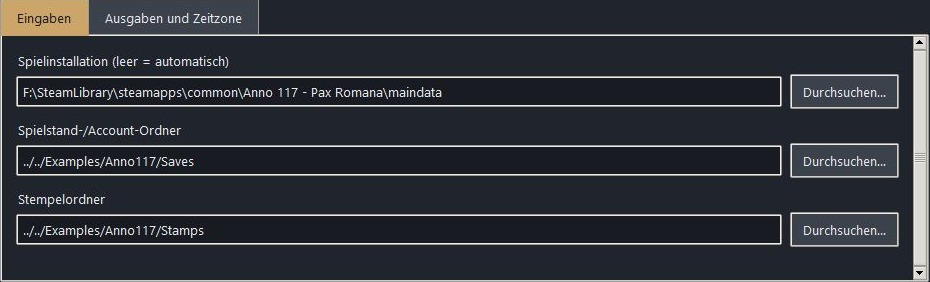

# ANNO - Organizer: die ersten Schritte

[English](desktop.md) · [Deutsch](desktop.de.md) · [Zur Übersicht](../README.de.md)

**Von der ersten Demo zur eigenen Galerie – am Beispiel von Anno 117: Pax Romana.** Du brauchst Windows 10/11 (64 Bit) und eine installierte Ausgabe von Anno 117. Die Bilder zeigen Beispieldaten; deine Ordner können anders heissen. Ein Klick auf ein Bild öffnet es in voller Grösse.

## 1. Herunterladen und öffnen

Auf der [Downloadseite](https://github.com/Morima79/AnnoOrganizer/releases/latest) die Datei mit **windows-x64.zip** im Namen herunterladen. Im Explorer mit der rechten Maustaste auf die ZIP-Datei klicken und **Alle extrahieren…** wählen. Im entpackten Ordner **AnnoOrganizer.exe** doppelt anklicken.

Den vollständigen Programmordner zusammenlassen. Python oder eine weitere Installation brauchst du nicht. Über **DE** und **EN** oben rechts wählst du deine Sprache. Über **Anleitung** links im Programm öffnest du diese Hilfe jederzeit, auch ohne Internet.

## 2. Zuerst die Demo ausprobieren

Links **Anno 117** wählen, unten **Mitgelieferte Demo** anklicken und **Erzeugen** drücken. Den Demo-Hinweis mit **OK** bestätigen und warten, bis **Auswertung abgeschlossen** erscheint.

Die Demo erstellt eine Karten- und eine Stempelgalerie aus den mitgelieferten Beispielen. Deine persönlichen Galerien bleiben dabei erhalten.

## 3. Die Galerie ansehen

Nach Abschluss auf **Galerien öffnen** klicken. Die Ergebnisse öffnen sich im Browser. Mit dem kleinen **Pfeil daneben** lässt sich eine einzelne Galerie auswählen. Wenn du **Galerien nach dem Erzeugen öffnen** anhakst, geschieht das künftig automatisch nach einem erfolgreichen Durchlauf.

In der Galerie kannst du suchen und filtern. Ein Klick auf eine Karte oder einen Bauplan öffnet die Grossansicht. **DE / EN** wechselt die Sprache.

**Excel-Bericht öffnen** bietet vorhandene Berichte des gewählten Spiels einschliesslich Demo-Berichten an und öffnet die gewählte Datei in der Windows-Standardanwendung. Das funktioniert auch nach einem Neustart und berücksichtigt separate Berichtsordner. Ein einzelner vorhandener Bericht öffnet sich direkt; wenn regulärer und Demo-Bericht vorhanden sind, erscheint eine Auswahl.

## 4. Deine eigenen Spielstände und Stempel verwenden

Im Programm beim Tab **Eingaben** die erkannten Ordner prüfen. Über **Durchsuchen…** kannst du sie ändern:

- **Spielinstallation:** Falls sie fehlt, die Anno-117-Spielanwendung auswählen.
- **Spielstand-/Account-Ordner:** Den Ordner mit deinen gespeicherten Partien wählen.
- **Stempelordner:** Den Ordner mit deinen Stempeln wählen.

Geänderte Ordner mit **Speichern** behalten. Dann unten **Karten und Excel** oder **Stempelgalerie** auswählen und **Erzeugen** drücken. Nach Abschluss wieder **Galerien öffnen** wählen.

**Mitgelieferte Demo** ist nur zum Ausprobieren. Für deine eigenen Daten eine der beiden anderen Aktionen wählen. Spielstände und Stempel werden ausschliesslich gelesen.

## Danach im Alltag

Nach einem neuen Spielstand oder Stempel auf **Alle Galerien aktualisieren** klicken. Das aktualisiert die eingerichteten Galerien; fehlende Spiele werden übersprungen. Mit **Abbrechen** kannst du einen laufenden Auftrag geordnet stoppen.

**Protokolle** zeigt den letzten Lauf des gewählten Spiels auch nach einem Neustart an. Beim Spielwechsel aktualisiert sich ein offenes Protokollfenster. Gemeinsame Aktualisierungen behalten Karten- und Stempelprotokolle pro Spiel zusammen; für Spiele ohne Lauf erscheint ein Leerzustand.

| Wenn etwas nicht klappt | Das hilft |
|---|---|
| Ein Ordner wird nicht gefunden | Bei **Eingaben** über **Durchsuchen…** den richtigen Ordner wählen und **Speichern** drücken. |
| Eine Excel-Auswertung lässt sich nicht aktualisieren | Die bisherige Datei in Excel schliessen und erneut **Erzeugen** drücken. |
| Es erscheint eine Fehlermeldung | **Protokolle** öffnen und die Meldung prüfen. Für eine Rückfrage den Meldungstext bereithalten. |

Anno 1800 wird auf dieselbe Weise bedient. Anno 1404 bietet eine Kartengalerie und benötigt dafür keine Spielinstallation; eine Stempelgalerie gibt es dort nicht.

[Weitere Einstellungen und technische Details](desktop-reference.de.md) · [Einstellungen im Detail](settings.de.md)

Inoffizielles Fan-Projekt von Morima79, ohne Verbindung zu Ubisoft. Nutzung auf eigene Gefahr gemäss [MIT-Lizenz](../LICENSE).
