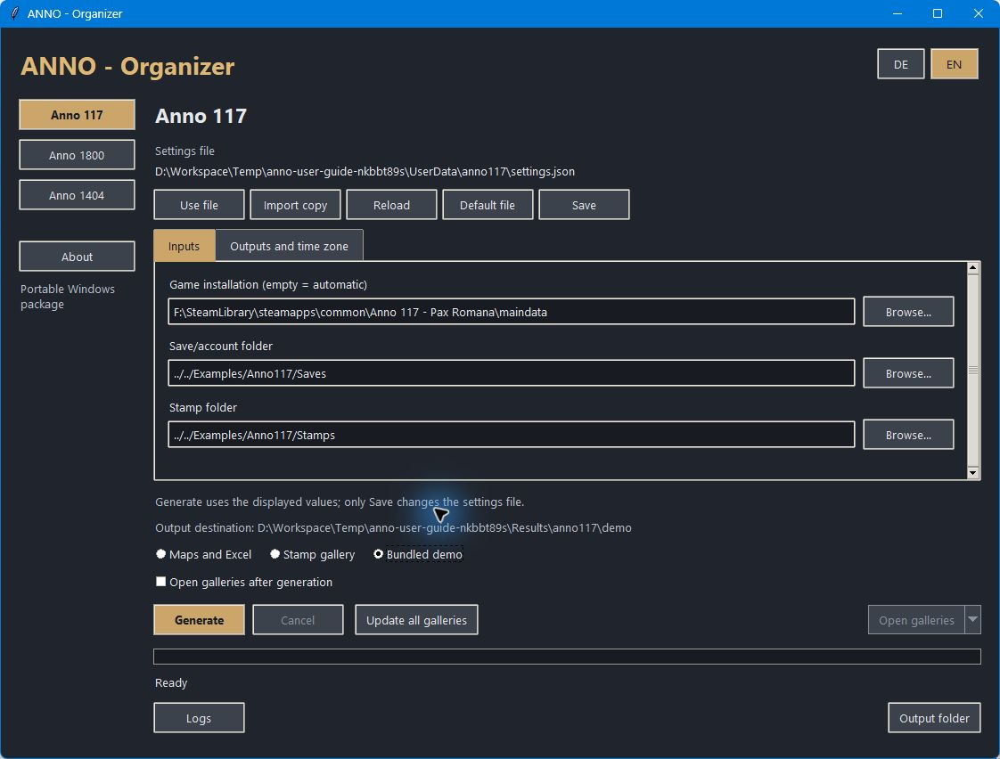
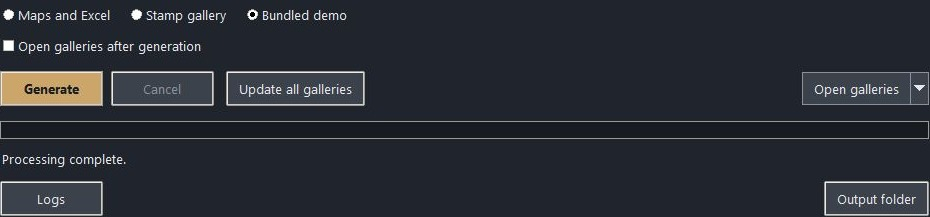
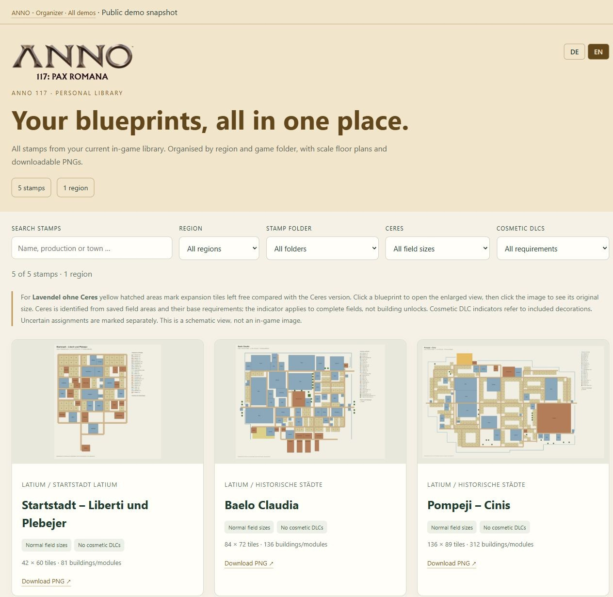
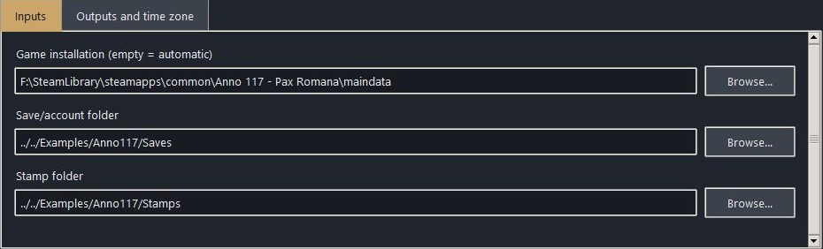

# ANNO - Organizer: getting started

[English](desktop.md) · [Deutsch](desktop.de.md) · [Overview](../README.md)

**From your first demo to your own gallery, using Anno 117: Pax Romana.** You need Windows 10/11 (64-bit) and an installed copy of Anno 117. The pictures use example data; your folders may have different names. Click any picture to view it at full size.

## 1. Download and open

On the [download page](https://github.com/Morima79/AnnoOrganizer/releases/latest), download the file with **windows-x64.zip** in its name. In File Explorer, right-click the ZIP file and choose **Extract All…**. Open the extracted folder and double-click **AnnoOrganizer.exe**.

Keep the whole application folder together. You do not need Python or another installation. Use **DE** and **EN** at the top right to choose your language. **User guide** on the left opens this help at any time, even without an internet connection.

## 2. Try the demo first

Select **Anno 117** on the left, choose **Bundled demo** at the bottom and press **Generate**. Confirm the demo notice with **OK** and wait until **Processing complete** appears.

The demo creates a map gallery and a stamp gallery from the included examples. Your personal galleries are preserved.

## 3. View the gallery

When processing finishes, click **Open galleries**. Your results open in the browser. The small **arrow beside it** lets you choose an individual gallery. Enable **Open galleries after generation** to open results automatically after future successful runs.

Use search and filters in the gallery. Click a map or blueprint to open the enlarged view. **DE / EN** changes the language.

**Open Excel report** offers existing reports for the selected game, including demo reports, and opens the selected file in your Windows default application. It also finds reports after restarting the app and respects separate report folders. A single available report opens directly; if both regular and demo reports exist, a menu offers the choice.

## 4. Use your own saves and stamps

In the application, check the detected folders on the **Inputs** tab. Use **Browse…** to change them:

- **Game installation:** If it is missing, select the Anno 117 game application.
- **Save/account folder:** Choose the folder containing your saved games.
- **Stamp folder:** Choose the folder containing your stamps.

Press **Save** to keep changed folders. Then choose **Maps and Excel** or **Stamp gallery** at the bottom and press **Generate**. When it finishes, select **Open galleries** again.

**Bundled demo** is for trying the examples. Choose one of the other two actions for your own data. Saves and stamps are only read.

## Everyday use

After saving a new game or stamp, click **Update all galleries**. This updates the configured galleries and skips missing games. Use **Cancel** to stop a running task cleanly.

**Logs** shows the selected game's latest run, including after restarting the app. Switching games updates an open log window. Combined updates keep the map and stamp logs together for each game; games without a run show an empty state.

| If something goes wrong | What to do |
|---|---|
| A folder cannot be found | On **Inputs**, use **Browse…** to select the correct folder, then press **Save**. |
| An Excel report cannot be updated | Close the existing file in Excel and press **Generate** again. |
| An error message appears | Open **Logs** and check the message. Keep the message text when asking for help. |

Anno 1800 works the same way. Anno 1404 provides a map gallery without requiring a game installation; it does not have a stamp gallery.

[More settings and technical details](desktop-reference.md) · [Detailed settings](settings.de.md)

Unofficial fan project by Morima79, unaffiliated with Ubisoft. Use at your own risk under the [MIT licence](../LICENSE).
